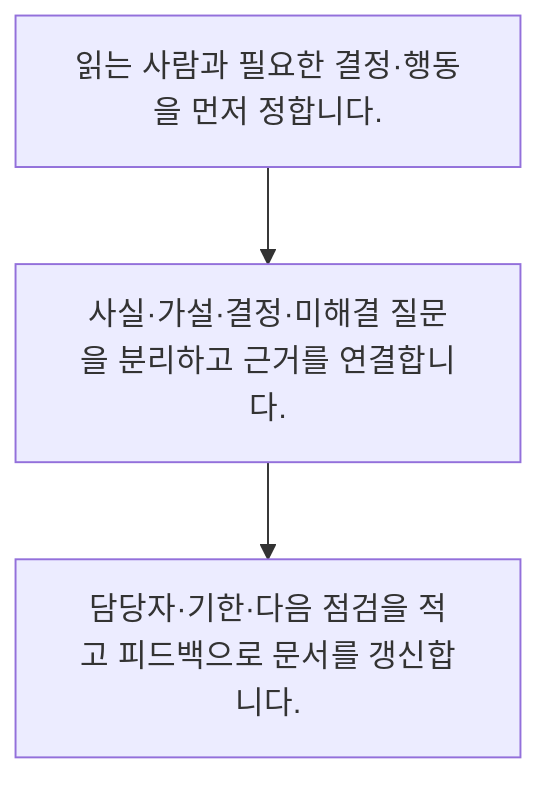

<!-- level:1 -->
# 기술 문서·ADR·상태 공유·협업

> **한 문장으로:** 기술 커뮤니케이션은 어려운 말을 많이 쓰는 일이 아니라, 상대가 이해하고 결정하고 행동할 정보를 전달하는 일입니다.

## 왜 필요한가요?

ADR은 코드가 무엇을 하는지만 반복하지 않고 왜 그 대안을 골랐는지 보존합니다. 진행 공유는 완료한 일·막힌 이유·도움이나 결정이 필요한 지점·다음 행동을 구분합니다. 사실과 추정을 섞으면 결정권자가 위험을 잘못 해석할 수 있습니다.

## 일상에서 떠올려 보기

길 안내를 할 때 지도 전체를 읽어 주기보다 목적지와 현재 위치, 다음 회전, 막혔을 때의 대안을 말합니다. 기술 문서도 읽는 사람의 결정과 다음 행동을 기준으로 구성하면 긴 설명 없이도 협업이 이어집니다.

## 순서대로 따라가기

1. 읽는 사람과 필요한 결정·행동을 먼저 정합니다.
2. 사실·가설·결정·미해결 질문을 분리하고 근거를 연결합니다.
3. 담당자·기한·다음 점검을 적고 피드백으로 문서를 갱신합니다.



## 처음 만나는 용어

| 용어 | 쉬운 뜻 |
|---|---|
| ADR | 중요한 설계 결정의 맥락·대안·이유·결과를 남긴 문서 |
| RFC | 결정 전에 제안과 질문을 공유해 검토를 받는 문서 |
| 상태 공유 | 진행·위험·결정 요청·다음 행동을 알리는 전달 |

**비유의 한계:** 짧은 문서가 항상 좋은 것은 아닙니다. 재현·감사·인수인계에 필요한 근거는 연결하고 민감한 정보는 접근 범위와 보관 정책에 맞게 관리합니다.

## 스스로 확인

기술 문서 작성에서 먼저 정할 것은 무엇인가요?

**답과 이유:** 누가 읽고 무엇을 결정하거나 행동할지 — 독자의 목적을 알아야 필요한 맥락과 근거를 적절한 수준으로 전달할 수 있습니다.
<!-- level:2 -->
# 기술 문서·ADR·상태 공유·협업 — 실제 흐름 따라가기

## 읽기 전 길잡이

기술 커뮤니케이션은 어려운 말을 많이 쓰는 일이 아니라, 상대가 이해하고 결정하고 행동할 정보를 전달하는 일입니다. 아래 예제는 외부 시스템에 연결하지 않는 작은 학습용 사례입니다. 입력, 처리 조건, 결과를 순서대로 살펴보세요.

1. 읽는 사람과 필요한 결정·행동을 먼저 정합니다.
2. 사실·가설·결정·미해결 질문을 분리하고 근거를 연결합니다.
3. 담당자·기한·다음 점검을 적고 피드백으로 문서를 갱신합니다.

## 예제로 확인하기

```markdown
# ADR: 검색 결과 캐시 범위
- 상태: 승인
- 맥락: 같은 문의가 반복되지만 문서 권한은 사용자별로 다름
- 대안 A: 모든 사용자에게 같은 결과 캐시
- 대안 B: 권한 범위를 포함해 캐시 구분
- 결정: B, 권한 검사 뒤 사용하며 정책 변경 시 무효화
- 이유: 캐시 적중률보다 데이터 격리 우선
- 결과: 키 수와 무효화 운영 비용 증가
- 담당·점검: 검색 담당자, 권한 정책 변경 시 재검토
```

## 결과를 해석하기

ADR은 코드가 무엇을 하는지만 반복하지 않고 왜 그 대안을 골랐는지 보존합니다. 진행 공유는 완료한 일·막힌 이유·도움이나 결정이 필요한 지점·다음 행동을 구분합니다. 사실과 추정을 섞으면 결정권자가 위험을 잘못 해석할 수 있습니다.

## 실무에 옮기기 전

짧은 문서가 항상 좋은 것은 아닙니다. 재현·감사·인수인계에 필요한 근거는 연결하고 민감한 정보는 접근 범위와 보관 정책에 맞게 관리합니다. 실제 업무에서는 빠른 논의는 채팅으로 하더라도 중요한 최종 결정은 검색 가능한 문서에 요약합니다. 독자의 목적에 따라 요약과 근거를 나누고, 상태·소유자·재검토 조건을 남겨 오래된 문서가 현재 정책처럼 쓰이지 않게 합니다.

## 확인 질문

ADR이 특히 보존해야 할 정보는 무엇인가요?

**답과 이유:** 구현이 바뀌어도 선택 이유와 제약을 이해할 수 있어야 다음 결정을 돕습니다.
<!-- level:3 -->
# 기술 문서·ADR·상태 공유·협업 — 가상 사례로 문제 해결하기

실제 고객의 장애 기록이 아닌 학습용 재현 시나리오입니다. 결과만 바꾸기 전에 관측한 증거와 원인 가설을 구분합니다.

## 1. 어떤 문제가 생겼나요?

담당자가 바뀐 뒤 캐시 격리 설정이 불필요해 보여 삭제됩니다.

## 2. 먼저 확인할 증거

코드 설명은 있지만 사용자별 권한을 보호하려고 선택했다는 이유가 없습니다.

## 3. 원인 가설

구현 설명만 남기고 결정 맥락과 감수한 비용을 기록하지 않은 것이 원인 가설입니다.

## 4. 수정 방법

결정을 복구하고 ADR에 보안 조건·대안·이유·검증 사례를 연결합니다.

## 5. 재검증

새 담당자가 문서를 읽고 선택 이유와 변경 시 확인할 조건을 설명할 수 있는지 점검합니다.

## 놓치기 쉬운 조건

짧은 문서가 항상 좋은 것은 아닙니다. 재현·감사·인수인계에 필요한 근거는 연결하고 민감한 정보는 접근 범위와 보관 정책에 맞게 관리합니다.

## 확인 질문

설계 이유가 사라져 보호 설정을 삭제했다면 무엇을 보완하나요?

**답과 이유:** 설계의 의도와 제약을 남겨야 새 담당자가 위험을 이해하고 변경할 수 있습니다.
<!-- level:4 -->
# 기술 문서·ADR·상태 공유·협업 — 업무와 아키텍처의 선택

## 읽기 전 길잡이

같은 개념도 업무의 규모, 오류 비용, 운영 역량에 따라 적용 방식이 달라집니다. 아래 비교는 특정 제품의 성능 순위가 아닌 선택 기준입니다.

| 선택 | 얻는 점 | 감수할 점 |
|---|---|---|
| 결정 로그·ADR | 선택의 이유를 추적하고 인수인계에 유리 | 작성 후 바뀐 상태를 갱신해야 함 |
| 채팅 중심 공유 | 빠른 질문과 합의에 편리 | 시간이 지나면 근거와 최종 결정을 찾기 어려움 |

## 선택 기준

빠른 논의는 채팅으로 하더라도 중요한 최종 결정은 검색 가능한 문서에 요약합니다. 독자의 목적에 따라 요약과 근거를 나누고, 상태·소유자·재검토 조건을 남겨 오래된 문서가 현재 정책처럼 쓰이지 않게 합니다.

## 도입과 운영에서 확인할 것

결정을 복구하고 ADR에 보안 조건·대안·이유·검증 사례를 연결합니다. 새 담당자가 문서를 읽고 선택 이유와 변경 시 확인할 조건을 설명할 수 있는지 점검합니다.

## 판단 연습

채팅으로 중요한 결정을 내린 뒤 적절한 행동은 무엇인가요?

**판단의 근거:** 빠른 대화와 지속 가능한 기록을 연결해야 인수인계와 추적이 가능합니다.

참고: [GOV.UK Service Manual](https://www.gov.uk/service-manual), [WCAG 2.2](https://www.w3.org/TR/WCAG22/).
<!-- quizzes -->
[{"level":1,"question":"기술 문서 작성에서 먼저 정할 것은 무엇인가요?","choices":["문서 페이지 수","코드 줄 수만","누가 읽고 무엇을 결정하거나 행동할지","전문 용어 개수"],"answer_index":2,"explanation":"독자의 목적을 알아야 필요한 맥락과 근거를 적절한 수준으로 전달할 수 있습니다."},{"level":2,"question":"ADR이 특히 보존해야 할 정보는 무엇인가요?","choices":["코드 전체 복사","담당자의 취미","회의 시간만","맥락·대안·결정 이유와 결과"],"answer_index":3,"explanation":"구현이 바뀌어도 선택 이유와 제약을 이해할 수 있어야 다음 결정을 돕습니다."},{"level":3,"question":"설계 이유가 사라져 보호 설정을 삭제했다면 무엇을 보완하나요?","choices":["결정 맥락과 보안 조건·검증 근거","문서 제목만","채팅 이모지만","모든 변경 금지"],"answer_index":0,"explanation":"설계의 의도와 제약을 남겨야 새 담당자가 위험을 이해하고 변경할 수 있습니다."},{"level":4,"question":"채팅으로 중요한 결정을 내린 뒤 적절한 행동은 무엇인가요?","choices":["담당자 변경 시까지 기다린다","최종 결정과 이유·소유자를 검색 가능한 문서로 남긴다","모든 대화를 무작정 복사","근거 삭제"],"answer_index":1,"explanation":"빠른 대화와 지속 가능한 기록을 연결해야 인수인계와 추적이 가능합니다."}]
