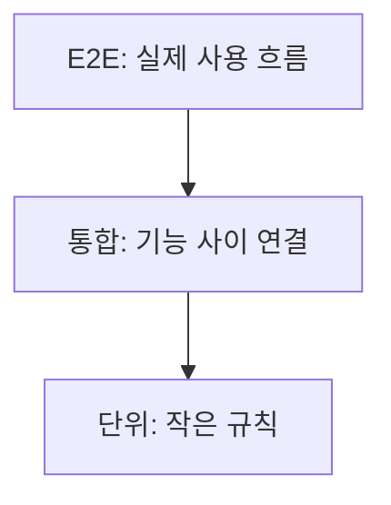

<!-- level:1 -->
# 테스트 피라미드 — 작은 규칙부터 실제 사용 흐름까지

> **한 문장으로:** 빠른 작은 검사와 실제 연결을 확인하는 검사를 함께 써서 오류를 찾는 비용을 조절합니다.

## 왜 필요한가요?

함수 하나는 맞아도 데이터베이스 연결이나 화면 사용 흐름에서 실패할 수 있습니다. 반대로 모든 검사를 브라우저로만 하면 느리고 원인 찾기가 어려워질 수 있습니다.

## 일상에서 떠올려 보기

자동차의 부품을 따로 검사하고, 조립된 장치도 시험하고, 완성 차량을 실제로 주행하는 과정을 떠올려 보세요. 한 종류만 통과했다고 전체가 안전하게 작동하는 것은 아닙니다.

## 순서대로 따라가기

1. 단위 테스트로 작은 계산이나 규칙을 빠르게 확인합니다.
2. 통합 테스트로 코드와 실제 의존성의 연결을 확인합니다.
3. E2E 테스트로 사용자가 화면에서 행동한 뒤 결과까지 이어지는 대표 흐름을 확인합니다.



## 작은 예로 확인하기

배송비 함수는 금액별 결과를 작은 테스트로 확인합니다. 주문 저장은 데이터베이스까지 연결해 확인합니다. 사용자가 상품을 선택하고 주문 결과를 보는 흐름은 브라우저 검사로 확인합니다. 같은 규칙을 모든 단계에 복제하기보다 단계별 책임을 정합니다.

## 처음 만나는 용어

| 용어 | 쉬운 뜻 |
|---|---|
| 단위 테스트 | 작은 코드 단위의 규칙과 결과를 확인하는 검사입니다. |
| 통합 테스트 | 여러 구성요소가 실제 약속대로 연결되는지 확인하는 검사입니다. |
| E2E | 처음 사용자 행동부터 최종 결과까지 이어서 확인하는 검사입니다. |
| 테스트 피라미드 | 검사 속도·비용·범위를 균형 있게 구성하는 관점입니다. |

**비유의 한계:** 피라미드는 테스트 개수의 고정 비율표가 아닙니다. 앱의 위험과 연결 구조에 따라 구성해야 합니다. 작은 테스트가 많아도 실제 데이터 계약을 확인하지 않으면 연결 오류를 놓칠 수 있습니다.

## 스스로 확인

단위 테스트가 모두 통과했는데 주문이 저장되지 않을 수 있을까요?

**답과 이유:** 가능합니다. 실제 데이터베이스 연결이나 계약의 문제일 수 있습니다. 작은 규칙 검사와 연결 검사는 서로 보완합니다.
<!-- level:2 -->
# 경계별로 검증 책임 지정하기

<!-- beginner-guide:start -->
## 읽기 전 길잡이

아래 예제의 입력, 기대 결과, 검사 명령을 먼저 찾으세요. 실제 외부 서비스를 호출하는지 작은 계산만 확인하는지도 구분합니다.

## 이 단계에서 만날 말

| 용어 | 쉬운 뜻 |
|---|---|
| assert | 결과가 기대 조건에 맞는지 확인하는 명령입니다. |
| mock | 검사에서 실제 의존성 대신 사용하는 대체물입니다. |
| 계약 테스트 | 구성요소 사이 입력과 응답의 약속을 확인하는 검사입니다. |
| fixture | 테스트에 필요한 입력과 환경을 마련하는 자료입니다. |
| flaky test | 같은 코드에서도 불안정하게 통과와 실패가 바뀌는 검사입니다. |
| 커버리지 | 테스트가 실행한 코드 등의 범위를 나타내는 지표입니다. |

<!-- beginner-guide:end -->

단위 테스트는 외부 효과 없이 업무 규칙을 확인한다. 통합 테스트는 실제 의존성 계약과 오류를 확인한다. E2E는 브라우저→API→DB 결과를 연결한다. 계약 테스트는 구현 사이 입력·결과 의미를 확인하는 도구다.

Node.js 내장 테스트 러너 예제다. `node --test fee.test.mjs`로 실행한다.

```javascript
import test from 'node:test';
import assert from 'node:assert/strict';
const fee = value => value >= 50000 ? 0 : 3000;
test('무료배송 경계', () => {
  assert.equal(fee(49999), 3000);
  assert.equal(fee(50000), 0);
});
```

이 테스트만으로 주문 저장·인가·결제 연동을 검증했다고 말할 수 없다. DB 통합 테스트는 트랜잭션·제약·RLS와 테스트 데이터 격리를 다루고, E2E는 사용자가 보이는 결과와 DB 상태를 확인한다. 고정 sleep보다 실제 상태를 기다리고 네트워크·시간 의존을 통제한다.
<!-- level:3 -->
# 가상 장애 — CI에서만 E2E가 가끔 실패한다

<!-- beginner-guide:start -->
## 읽기 전 길잡이

가끔만 실패하는 테스트는 시간·공유 데이터·실제 네트워크에 기대고 있는지 조사합니다. 실패를 무조건 재실행해 숨기기보다 재현 조건을 기록하세요.

<!-- beginner-guide:end -->

가상 테스트가 버튼 클릭 후 1초 sleep하고 결과를 검사해 느린 CI에서 실패한다. 먼저 앱 결함인지 테스트 동기화·공유 데이터·순서 의존인지 구분한다. 재시도만 늘리면 문제를 숨길 수 있다.

**진단:** 요청·응답·브라우저 상태와 테스트 데이터 ID를 실패 시 보관한다. 다른 테스트와 같은 계정을 공유해 진도가 바뀌는지, 비동기 작업 완료 전에 확인하는지 조사한다. 민감한 인증 토큰은 기록에서 제외한다.

**수정:** 관측 가능한 완료 상태를 조건으로 기다리고 데이터·계정을 격리한다. 느린 외부 시스템은 계약 검증과 별도 통합 흐름으로 나눌 수 있다. 재시도는 일시적 환경 실패를 구분할 근거와 함께 제한한다.

**재검증:** 병렬·순서 변경·느린 네트워크에서 반복해 flaky 비율, 실행 시간, 실제 결함 탐지력을 확인한다.
<!-- level:4 -->
# 위험에 맞는 검증 포트폴리오

<!-- beginner-guide:start -->
## 읽기 전 길잡이

어떤 장애를 놓치면 비용이 큰지 먼저 정합니다. 빠른 검사로 찾을 문제와 실제 환경 연결이 필요한 문제를 나눠 실행 시간과 신뢰도를 비교하세요.

<!-- beginner-guide:end -->

| 검사 | 강점 | 놓칠 수 있는 것 |
|---|---|---|
| 단위 | 빠른 경계·업무 규칙 피드백 | 실제 통합·권한 |
| 통합 | DB·API·직렬화 계약 | 전체 사용자 동선 |
| E2E | 실제 연결과 UX | 많은 입력 조합·빠른 원인 분석 |

결제·권한·데이터 무결성은 실패 비용이 커 경계와 통합 검증을 강화한다. 단순 문구 변경마다 구현과 같은 테스트를 만들면 유지 비용만 늘 수 있다. 부하·복구·보안 검사는 기능 E2E와 다른 질문에 답한다.

**판단 연습:** 퀴즈 정답 숨김, RLS 소유권, 브라우저 레벨 탭을 각각 어느 검사에서 보장할까? 검증 책임과 근거를 연결하자.

참고: [The Practical Test Pyramid](https://martinfowler.com/articles/practical-test-pyramid.html), [Node.js Test Runner](https://nodejs.org/api/test.html).
<!-- quizzes -->
[{"level":1,"question":"테스트 피라미드의 목적을 정확히 설명한 것은?","choices":["고정 숫자 비율 달성","모든 E2E 삭제","빠른 피드백과 실제 연결 검증의 균형","커버리지 100이면 버그 없음"],"answer_index":2,"explanation":"피라미드는 비용과 실패 탐지력을 균형 있게 구성하는 휴리스틱입니다. 테스트 수나 커버리지 하나가 품질을 보증하지 않습니다."},{"level":2,"question":"업무 계산의 단위 테스트만으로 보장하지 못하는 것은?","choices":["실제 DB 제약·RLS·직렬화 연결","해당 입력의 반환값","비교 경계 조건","순수 함수의 예외"],"answer_index":0,"explanation":"작은 계산 테스트는 연결과 권한을 실행하지 않습니다. 통합·E2E 검증에서 해당 경계를 확인해야 합니다."},{"level":3,"question":"고정 sleep 때문에 CI에서 흔들리는 테스트의 개선은?","choices":["모든 오류를 재시도로 숨김","완료 상태를 기다리고 데이터 격리","sleep을 무제한 증가","실패 결과 삭제"],"answer_index":1,"explanation":"실제 상태 기반 대기와 독립 데이터가 타이밍·순서 의존을 줄입니다. 앱 결함과 환경 실패를 구분해야 합니다."},{"level":4,"question":"검증 범위의 우선순위로 적절한 것은?","choices":["파일 크기만","모든 수정에 같은 테스트 수","가장 쉬운 성공 흐름만","실패 비용·변경 위험·경계의 중요도"],"answer_index":3,"explanation":"권한·결제·무결성처럼 실패 비용이 큰 경계를 더 강하게 검증합니다. 비용 대비 탐지력을 평가해야 합니다."}]
