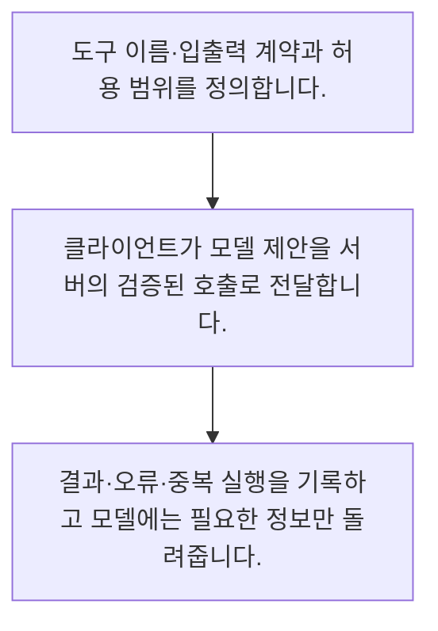

<!-- level:1 -->
# 도구 호출·MCP와 서버 검증

> **한 문장으로:** 모델의 도구 호출은 실행 제안이며 실제 서버가 인자·사용자 권한·업무 조건을 검증한 뒤 실행합니다.

## 왜 필요한가요?

허용 도구와 자원 범위를 점검하는 모형입니다. 실제 구현은 서버의 인증 주체, 스키마·소유권·업무 상태와 감사 기록을 연결합니다. 모델이 작성한 사용자 ID나 허용 여부를 신뢰하지 않습니다.

## 일상에서 떠올려 보기

비서가 요청서를 작성했다고 계좌 이체가 끝난 것은 아닙니다. 담당 시스템이 요청자의 권한과 금액·대상을 확인해야 합니다.

## 순서대로 따라가기

1. 도구 이름·입출력 계약과 허용 범위를 정의합니다.
2. 클라이언트가 모델 제안을 서버의 검증된 호출로 전달합니다.
3. 결과·오류·중복 실행을 기록하고 모델에는 필요한 정보만 돌려줍니다.



## 처음 만나는 용어

| 용어 | 쉬운 뜻 |
|---|---|
| 도구 호출 | 모델이 프로그램 기능의 이름과 인자를 제안하는 출력 |
| MCP | AI 앱과 외부 도구·자료를 연결하는 클라이언트·서버 규격 |
| 서버 권한 검사 | 인증된 사용자가 해당 자원과 작업에 접근 가능한지 확인하는 절차 |

**비유의 한계:** MCP 같은 연결 규격이 인증·권한과 안전을 자동 보장하지 않습니다. 도구 설명과 외부 자료도 공격 입력이 될 수 있으므로 신뢰 경계를 유지합니다.

## 스스로 확인

모델이 만든 도구 호출은 무엇인가요?

**답과 이유:** 검증해야 하는 실행 제안 — 모델 제안과 권한 있는 실행은 구분해야 합니다.
<!-- level:2 -->
# 도구 호출·MCP와 서버 검증 — 실제 흐름 따라가기

## 읽기 전 길잡이

모델의 도구 호출은 실행 제안이며 실제 서버가 인자·사용자 권한·업무 조건을 검증한 뒤 실행합니다. 아래 예제는 외부 시스템에 연결하지 않는 작은 학습용 사례입니다. 입력, 처리 조건, 결과를 순서대로 살펴보세요.

1. 도구 이름·입출력 계약과 허용 범위를 정의합니다.
2. 클라이언트가 모델 제안을 서버의 검증된 호출로 전달합니다.
3. 결과·오류·중복 실행을 기록하고 모델에는 필요한 정보만 돌려줍니다.

## 예제로 확인하기

```python
call={"tool":"read_ticket","args":{"ticket_id":7}}
allowed_tools={"read_ticket"}; allowed_ids={7,8}
assert call["tool"] in allowed_tools
assert call["args"]["ticket_id"] in allowed_ids
print("검증된 읽기 요청 예시")
```

## 결과를 해석하기

허용 도구와 자원 범위를 점검하는 모형입니다. 실제 구현은 서버의 인증 주체, 스키마·소유권·업무 상태와 감사 기록을 연결합니다. 모델이 작성한 사용자 ID나 허용 여부를 신뢰하지 않습니다.

## 실무에 옮기기 전

MCP 같은 연결 규격이 인증·권한과 안전을 자동 보장하지 않습니다. 도구 설명과 외부 자료도 공격 입력이 될 수 있으므로 신뢰 경계를 유지합니다. 실제 업무에서는 연결 방식과 무관하게 인증·권한·인자 검증을 서버 경계에 둡니다. 쓰기 도구는 승인·멱등성·되돌리기 가능성을 읽기 도구와 별도로 설계합니다.

## 확인 질문

예제에서 검사하는 것은?

**답과 이유:** 스키마 외에 어떤 자원까지 접근 가능한지도 확인합니다.
<!-- level:3 -->
# 도구 호출·MCP와 서버 검증 — 가상 사례로 문제 해결하기

실제 고객의 장애 기록이 아닌 학습용 재현 시나리오입니다. 결과만 바꾸기 전에 관측한 증거와 원인 가설을 구분합니다.

## 1. 어떤 문제가 생겼나요?

가상 에이전트가 다른 팀 티켓을 읽으려 합니다.

## 2. 먼저 확인할 증거

인증 주체·도구 인자·자원 소유권과 서버 접근 로그를 대조합니다.

## 3. 원인 가설

모델이 만든 조직 ID를 권한 근거로 사용했습니다.

## 4. 수정 방법

서버 세션에서 조직 범위를 결정하고 자원별 검사를 수행합니다.

## 5. 재검증

다른 테넌트 ID·변조 인자·허용되지 않은 도구가 거부되는지 검사합니다.

## 놓치기 쉬운 조건

MCP 같은 연결 규격이 인증·권한과 안전을 자동 보장하지 않습니다. 도구 설명과 외부 자료도 공격 입력이 될 수 있으므로 신뢰 경계를 유지합니다.

## 확인 질문

다른 팀 자료를 읽으려 할 때 권한 근거는?

**답과 이유:** 권한은 신뢰할 수 있는 서버 정보에서 결정해야 합니다.
<!-- level:4 -->
# 도구 호출·MCP와 서버 검증 — 업무와 아키텍처의 선택

## 읽기 전 길잡이

같은 개념도 업무의 규모, 오류 비용, 운영 역량에 따라 적용 방식이 달라집니다. 아래 비교는 특정 제품의 성능 순위가 아닌 선택 기준입니다.

| 선택 | 얻는 점 | 감수할 점 |
|---|---|---|
| 직접 도구 API | 구조와 통제를 명시하기 쉬움 | 연결별 구현 부담 |
| MCP 기반 연결 | 도구·자료 연결의 공통 인터페이스 | 서버 신뢰·범위·버전 관리 |

## 선택 기준

연결 방식과 무관하게 인증·권한·인자 검증을 서버 경계에 둡니다. 쓰기 도구는 승인·멱등성·되돌리기 가능성을 읽기 도구와 별도로 설계합니다.

## 도입과 운영에서 확인할 것

서버 세션에서 조직 범위를 결정하고 자원별 검사를 수행합니다. 다른 테넌트 ID·변조 인자·허용되지 않은 도구가 거부되는지 검사합니다.

## 판단 연습

MCP 도입 후에도 필요한 것은?

**판단의 근거:** 연결 규격과 업무 보안 통제는 서로 다른 책임입니다.

참고: [Anthropic 에이전트 설계](https://www.anthropic.com/engineering/building-effective-agents), [MCP 소개](https://modelcontextprotocol.io/docs/getting-started/intro), [OWASP 생성형 AI 보안](https://genai.owasp.org/llm-top-10/).
<!-- quizzes -->
[{"level":1,"question":"모델이 만든 도구 호출은 무엇인가요?","choices":["이미 승인된 실행","권한 증명","서버 정책 대체","검증해야 하는 실행 제안"],"answer_index":3,"explanation":"모델 제안과 권한 있는 실행은 구분해야 합니다."},{"level":2,"question":"예제에서 검사하는 것은?","choices":["허용 도구와 티켓 범위","모델 자신감","문장 길이","서버 색상"],"answer_index":0,"explanation":"스키마 외에 어떤 자원까지 접근 가능한지도 확인합니다."},{"level":3,"question":"다른 팀 자료를 읽으려 할 때 권한 근거는?","choices":["도구 설명 문장만","서버의 인증 주체·자원 정책","모델이 쓴 조직 ID","응답의 자신감"],"answer_index":1,"explanation":"권한은 신뢰할 수 있는 서버 정보에서 결정해야 합니다."},{"level":4,"question":"MCP 도입 후에도 필요한 것은?","choices":["승인 생략","입력 무제한","서버 인증·권한·계약 검증","모든 도구 공개"],"answer_index":2,"explanation":"연결 규격과 업무 보안 통제는 서로 다른 책임입니다."}]
