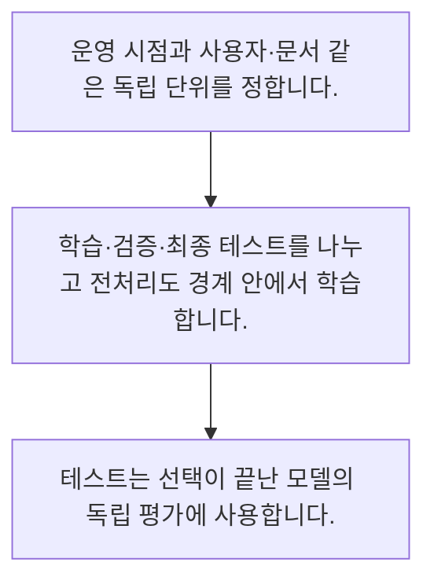

<!-- level:1 -->
# 학습·검증·테스트와 데이터 누출

> **한 문장으로:** 모델 조정에 쓴 자료와 최종 평가 자료를 분리하고 실제 사용 시점에 없는 정보가 섞이지 않게 합니다.

## 왜 필요한가요?

시험 문제를 미리 외운 학생의 점수로 처음 보는 문제의 실력을 판단할 수는 없습니다. AI도 학습에 쓴 자료와 평가에 쓸 자료를 나눠야 새로운 상황의 성능을 확인할 수 있습니다.

## 일상에서 떠올려 보기

연습 문제의 답을 외운 뒤 같은 시험을 보면 실력을 과대평가합니다. 비슷한 지문이 다른 시험지에 복제돼 있어도 마찬가지입니다.

## 순서대로 따라가기

1. 운영 시점과 사용자·문서 같은 독립 단위를 정합니다.
2. 학습·검증·최종 테스트를 나누고 전처리도 경계 안에서 학습합니다.
3. 테스트는 선택이 끝난 모델의 독립 평가에 사용합니다.



## 처음 만나는 용어

| 용어 | 쉬운 뜻 |
|---|---|
| 학습 세트 | 모델의 파라미터를 조정하는 자료 |
| 검증 세트 | 설정과 방법 선택에 쓰는 자료 |
| 데이터 누출 | 평가나 미래 정보가 학습 과정에 부적절하게 들어오는 현상 |

**비유의 한계:** 무작위 분할이 언제나 적절하지 않습니다. 같은 사람의 기록과 시간 순서가 연결된 자료는 그룹·시점의 경계를 지켜야 합니다.

## 스스로 확인

검증 세트의 주된 용도는?

**답과 이유:** 설정과 방법 선택 — 학습으로 조정한 모델의 설정을 비교하는 데 쓰며 최종 테스트와 역할이 다릅니다.
<!-- level:2 -->
# 학습·검증·테스트와 데이터 누출 — 실제 흐름 따라가기

## 읽기 전 길잡이

모델 조정에 쓴 자료와 최종 평가 자료를 분리하고 실제 사용 시점에 없는 정보가 섞이지 않게 합니다. 아래 예제는 외부 시스템에 연결하지 않는 작은 학습용 사례입니다. 입력, 처리 조건, 결과를 순서대로 살펴보세요.

1. 운영 시점과 사용자·문서 같은 독립 단위를 정합니다.
2. 학습·검증·최종 테스트를 나누고 전처리도 경계 안에서 학습합니다.
3. 테스트는 선택이 끝난 모델의 독립 평가에 사용합니다.

## 예제로 확인하기

```python
train_users={"u1","u2"}; test_users={"u3"}
assert train_users.isdisjoint(test_users)
train_dates=[1,2,3]; test_dates=[4,5]
assert max(train_dates)<min(test_dates)
print("그룹과 시간 경계 확인")
```

## 결과를 해석하기

집합이 겹치지 않는지와 학습 시점이 테스트보다 과거인지 검사하는 작은 예입니다. 이것만으로 모든 누출을 탐지할 수는 없으며 입력 생성 시각과 전처리 학습 범위도 확인해야 합니다.

## 실무에 옮기기 전

무작위 분할이 언제나 적절하지 않습니다. 같은 사람의 기록과 시간 순서가 연결된 자료는 그룹·시점의 경계를 지켜야 합니다. 실제 업무에서는 실제 예측 대상이 새 사람인지 같은 사람의 미래인지에 맞춰 평가 경계를 정합니다. 테스트를 반복해서 설정 선택에 사용하면 더 이상 독립 평가라고 보기 어렵습니다.

## 확인 질문

예제의 isdisjoint가 확인하는 것은?

**답과 이유:** 같은 사용자가 경계를 넘는지 검사하는 집합 연산입니다.
<!-- level:3 -->
# 학습·검증·테스트와 데이터 누출 — 가상 사례로 문제 해결하기

실제 고객의 장애 기록이 아닌 학습용 재현 시나리오입니다. 결과만 바꾸기 전에 관측한 증거와 원인 가설을 구분합니다.

## 1. 어떤 문제가 생겼나요?

가상 모델이 오프라인에서는 우수하지만 신규 고객에게 실패합니다.

## 2. 먼저 확인할 증거

동일 고객·중복 문서의 분할 위치와 피처 생성 시각을 확인합니다.

## 3. 원인 가설

같은 고객의 유사 기록이 학습과 테스트에 모두 들어갔습니다.

## 4. 수정 방법

고객 단위 분할과 시간 기반 평가로 바꾸고 전처리를 학습 세트에서만 추정합니다.

## 5. 재검증

완전히 새 고객과 다음 기간의 보류 자료에서 다시 측정합니다.

## 놓치기 쉬운 조건

무작위 분할이 언제나 적절하지 않습니다. 같은 사람의 기록과 시간 순서가 연결된 자료는 그룹·시점의 경계를 지켜야 합니다.

## 확인 질문

신규 고객 성능이 낮으면 확인할 것은?

**답과 이유:** 연결된 기록이 섞이면 일반화 성능이 과대평가될 수 있습니다.
<!-- level:4 -->
# 학습·검증·테스트와 데이터 누출 — 업무와 아키텍처의 선택

## 읽기 전 길잡이

같은 개념도 업무의 규모, 오류 비용, 운영 역량에 따라 적용 방식이 달라집니다. 아래 비교는 특정 제품의 성능 순위가 아닌 선택 기준입니다.

| 선택 | 얻는 점 | 감수할 점 |
|---|---|---|
| 무작위 행 분할 | 독립 행에서 간단 | 그룹·시간 연결을 놓칠 수 있음 |
| 그룹·시간 기반 분할 | 운영 상황에 더 가까움 | 표본 감소와 분포 변화 해석 필요 |

## 선택 기준

실제 예측 대상이 새 사람인지 같은 사람의 미래인지에 맞춰 평가 경계를 정합니다. 테스트를 반복해서 설정 선택에 사용하면 더 이상 독립 평가라고 보기 어렵습니다.

## 도입과 운영에서 확인할 것

고객 단위 분할과 시간 기반 평가로 바꾸고 전처리를 학습 세트에서만 추정합니다. 완전히 새 고객과 다음 기간의 보류 자료에서 다시 측정합니다.

## 판단 연습

분할 방식의 우선 기준은?

**판단의 근거:** 평가가 실제 사용 조건을 반영해야 합니다.

참고: [Google ML Crash Course](https://developers.google.com/machine-learning/crash-course), [scikit-learn 평가](https://scikit-learn.org/stable/model_selection.html), [scikit-learn 흔한 실수](https://scikit-learn.org/stable/common_pitfalls.html).
<!-- quizzes -->
[{"level":1,"question":"검증 세트의 주된 용도는?","choices":["정답 없는 운영만","모든 자료 삭제","설정과 방법 선택","최종 결과를 영구 보증"],"answer_index":2,"explanation":"학습으로 조정한 모델의 설정을 비교하는 데 쓰며 최종 테스트와 역할이 다릅니다."},{"level":2,"question":"예제의 isdisjoint가 확인하는 것은?","choices":["확률 보정","학습 속도","데이터 암호화","사용자 집합의 비중복"],"answer_index":3,"explanation":"같은 사용자가 경계를 넘는지 검사하는 집합 연산입니다."},{"level":3,"question":"신규 고객 성능이 낮으면 확인할 것은?","choices":["같은 고객의 분할 누출","로고 크기","모델 이름 길이","테스트 삭제"],"answer_index":0,"explanation":"연결된 기록이 섞이면 일반화 성능이 과대평가될 수 있습니다."},{"level":4,"question":"분할 방식의 우선 기준은?","choices":["좋은 점수가 나오는 방식","실제 사용의 그룹·시간 구조","언제나 행 무작위","파일 크기만"],"answer_index":1,"explanation":"평가가 실제 사용 조건을 반영해야 합니다."}]
