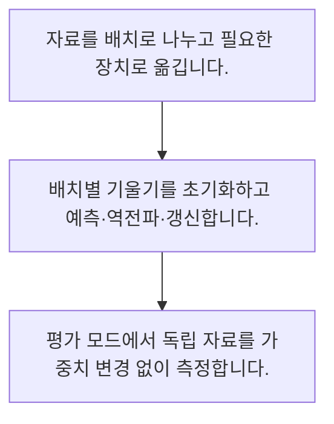

<!-- level:1 -->
# 학습 루프·미니배치·평가 모드

> **한 문장으로:** 학습은 배치마다 예측·손실·기울기·갱신을 반복하며 평가 단계와 모델 상태를 구분합니다.

## 왜 필요한가요?

7개 예제를 크기 3으로 나누면 마지막 배치는 1개입니다. 실제 루프가 마지막 작은 배치도 처리하는지, 기울기 누적이 의도한 것인지 확인해야 합니다.

## 일상에서 떠올려 보기

많은 시험 답안을 몇 장씩 묶어 검토하는 과정과 비슷합니다. 연습하며 기준을 바꾸는 시간과 최종 채점 시간은 구분해야 합니다.

## 순서대로 따라가기

1. 자료를 배치로 나누고 필요한 장치로 옮깁니다.
2. 배치별 기울기를 초기화하고 예측·역전파·갱신합니다.
3. 평가 모드에서 독립 자료를 가중치 변경 없이 측정합니다.



## 처음 만나는 용어

| 용어 | 쉬운 뜻 |
|---|---|
| 배치 | 한 번의 연산에 함께 넣는 예제 묶음 |
| 에포크 | 학습 자료를 한 차례 순회하는 단위 |
| 평가 모드 | dropout 등 학습과 다른 동작을 선택한 모델 상태 |

**비유의 한계:** 미니배치 크기는 단순히 클수록 좋은 값이 아닙니다. 장치 메모리·일반화·학습률과 관계가 있고 평가 모드와 미분 비활성화도 서로 다른 개념입니다.

## 스스로 확인

학습에서 에포크는 무엇을 뜻하나요?

**답과 이유:** 학습 자료 한 차례 순회 — 배치 갱신과 자료 전체 순회의 단위를 구분합니다.
<!-- level:2 -->
# 학습 루프·미니배치·평가 모드 — 실제 흐름 따라가기

## 읽기 전 길잡이

학습은 배치마다 예측·손실·기울기·갱신을 반복하며 평가 단계와 모델 상태를 구분합니다. 아래 예제는 외부 시스템에 연결하지 않는 작은 학습용 사례입니다. 입력, 처리 조건, 결과를 순서대로 살펴보세요.

1. 자료를 배치로 나누고 필요한 장치로 옮깁니다.
2. 배치별 기울기를 초기화하고 예측·역전파·갱신합니다.
3. 평가 모드에서 독립 자료를 가중치 변경 없이 측정합니다.

## 예제로 확인하기

```python
values=list(range(7)); batch_size=3
batches=[values[i:i+batch_size] for i in range(0,len(values),batch_size)]
assert list(map(len,batches))==[3,3,1]
print(batches)
```

## 결과를 해석하기

7개 예제를 크기 3으로 나누면 마지막 배치는 1개입니다. 실제 루프가 마지막 작은 배치도 처리하는지, 기울기 누적이 의도한 것인지 확인해야 합니다.

## 실무에 옮기기 전

미니배치 크기는 단순히 클수록 좋은 값이 아닙니다. 장치 메모리·일반화·학습률과 관계가 있고 평가 모드와 미분 비활성화도 서로 다른 개념입니다. 실제 업무에서는 장치 사용률만 높이기보다 목표 품질에 도달하는 총 시간과 메모리를 비교합니다. 검증 평균을 배치별 단순 평균할지 표본 수로 가중할지도 명확히 합니다.

## 확인 질문

예제의 배치 크기 목록은?

**답과 이유:** 남은 마지막 예제 하나도 배치로 만들어집니다.
<!-- level:3 -->
# 학습 루프·미니배치·평가 모드 — 가상 사례로 문제 해결하기

실제 고객의 장애 기록이 아닌 학습용 재현 시나리오입니다. 결과만 바꾸기 전에 관측한 증거와 원인 가설을 구분합니다.

## 1. 어떤 문제가 생겼나요?

가상 평가 결과가 실행할 때마다 크게 바뀝니다.

## 2. 먼저 확인할 증거

평가 모드 설정, dropout, 자료 순서와 난수 상태를 확인합니다.

## 3. 원인 가설

학습 모드를 유지한 채 검증했습니다.

## 4. 수정 방법

평가 모드와 미분 설정을 명시하고 검증 중 갱신을 막습니다.

## 5. 재검증

동일 입력 반복 결과와 마지막 작은 배치의 집계 가중치를 검사합니다.

## 놓치기 쉬운 조건

미니배치 크기는 단순히 클수록 좋은 값이 아닙니다. 장치 메모리·일반화·학습률과 관계가 있고 평가 모드와 미분 비활성화도 서로 다른 개념입니다.

## 확인 질문

평가가 매번 크게 달라지면 먼저 확인할 것은?

**답과 이유:** 학습용 확률적 동작이 검증에 남았는지 확인해야 합니다.
<!-- level:4 -->
# 학습 루프·미니배치·평가 모드 — 업무와 아키텍처의 선택

## 읽기 전 길잡이

같은 개념도 업무의 규모, 오류 비용, 운영 역량에 따라 적용 방식이 달라집니다. 아래 비교는 특정 제품의 성능 순위가 아닌 선택 기준입니다.

| 선택 | 얻는 점 | 감수할 점 |
|---|---|---|
| 작은 배치 | 메모리 부담 감소 | 갱신 변동·처리 효율 문제 |
| 큰 배치·누적 | 처리량·유효 배치 조절 | 메모리·학습 설정 관리 |

## 선택 기준

장치 사용률만 높이기보다 목표 품질에 도달하는 총 시간과 메모리를 비교합니다. 검증 평균을 배치별 단순 평균할지 표본 수로 가중할지도 명확히 합니다.

## 도입과 운영에서 확인할 것

평가 모드와 미분 설정을 명시하고 검증 중 갱신을 막습니다. 동일 입력 반복 결과와 마지막 작은 배치의 집계 가중치를 검사합니다.

## 판단 연습

배치 크기의 합리적 선택 기준은?

**판단의 근거:** 처리량·메모리·일반화가 함께 변할 수 있습니다.

참고: [PyTorch 기초](https://docs.pytorch.org/tutorials/beginner/basics/intro.html), [Attention Is All You Need](https://arxiv.org/abs/1706.03762), [DDPM 논문](https://arxiv.org/abs/2006.11239).
<!-- quizzes -->
[{"level":1,"question":"학습에서 에포크는 무엇을 뜻하나요?","choices":["파라미터 한 개","한 고객","검증 결과 한 숫자","학습 자료 한 차례 순회"],"answer_index":3,"explanation":"배치 갱신과 자료 전체 순회의 단위를 구분합니다."},{"level":2,"question":"예제의 배치 크기 목록은?","choices":["3·3·1","3·3·3","7·7","1·1·1"],"answer_index":0,"explanation":"남은 마지막 예제 하나도 배치로 만들어집니다."},{"level":3,"question":"평가가 매번 크게 달라지면 먼저 확인할 것은?","choices":["매번 재학습만","평가 모드와 난수 조건","모델 이름","로그 색상"],"answer_index":1,"explanation":"학습용 확률적 동작이 검증에 남았는지 확인해야 합니다."},{"level":4,"question":"배치 크기의 합리적 선택 기준은?","choices":["언제나 1","GPU 이름만","품질 도달 시간과 메모리","언제나 최댓값"],"answer_index":2,"explanation":"처리량·메모리·일반화가 함께 변할 수 있습니다."}]
