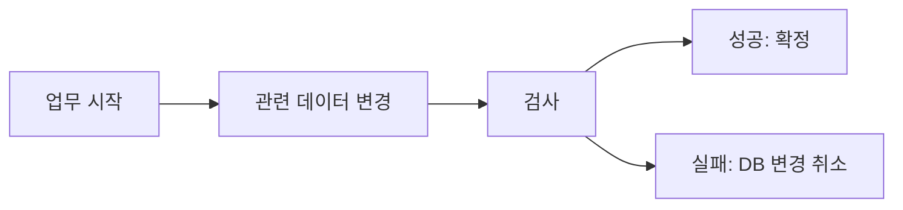

<!-- level:1 -->
# 트랜잭션과 격리 — 여러 변경을 하나의 업무로 처리하기

> **한 문장으로:** 관련된 데이터 변경을 한 묶음으로 처리하고 다른 작업이 그 중간 상태를 어떻게 볼지 정합니다.

## 왜 필요한가요?

재고는 줄었는데 주문이 저장되지 않으면 자료가 어긋납니다. 여러 변경의 성공·실패를 연결하고 동시에 처리하는 요청의 관계도 관리해야 합니다.

## 일상에서 떠올려 보기

예약 장부에서 좌석을 줄이고 예약자 이름을 적는 두 행동을 하나의 예약 업무로 생각해 보세요. 둘 다 끝내거나 장부 변경을 되돌려야 합니다. 다른 직원이 진행 중인 장부를 언제 볼지도 규칙으로 정합니다.

## 순서대로 따라가기

1. 함께 성공해야 할 변경들을 하나의 트랜잭션으로 시작합니다.
2. 검사와 변경을 수행하고 성공하면 commit으로 확정합니다.
3. 실패하면 rollback으로 해당 데이터베이스 변경을 되돌립니다. 동시에 실행되는 작업과의 충돌도 처리합니다.



## 작은 예로 확인하기

주문 저장 도중 고객에게 이메일을 이미 보냈다면 DB rollback으로 그 메일을 회수할 수 없습니다. 데이터베이스 안의 변경 범위와 바깥 효과의 범위는 다릅니다. 메일 발송 시점과 재처리 규칙을 별도로 정해야 합니다.

## 처음 만나는 용어

| 용어 | 쉬운 뜻 |
|---|---|
| 트랜잭션 | 관련된 데이터 작업을 성공·실패의 한 단위로 다루는 묶음입니다. |
| commit | 트랜잭션의 변경을 확정하는 것입니다. |
| rollback | 트랜잭션의 데이터베이스 변경을 취소하는 것입니다. |
| 격리 수준 | 동시에 진행 중인 다른 작업의 값을 어떻게 읽고 충돌을 다룰지 정한 규칙입니다. |

**비유의 한계:** 트랜잭션을 쓴다고 모든 업무 규칙과 외부 효과가 자동으로 보호되지는 않습니다. 선택한 격리 수준, 제약, 실패 재시도 범위를 함께 설계해야 합니다.

## 스스로 확인

DB 변경을 취소하면 이미 발송된 이메일도 자동으로 취소될까요?

**답과 이유:** 아닙니다. 이메일은 데이터베이스 밖의 효과입니다. 발송과 데이터 확정의 경계를 따로 설계해야 합니다.
<!-- level:2 -->
# PostgreSQL 17의 스냅샷과 충돌

<!-- beginner-guide:start -->
## 읽기 전 길잡이

아래 SQL은 서로 다른 세션에서 무엇을 볼 수 있는지 확인하는 학습 예제입니다. 읽는 시점과 값이 바뀌는 시점을 분리해 적어 보세요. 충돌 실패가 발생하면 전체 업무 재시도가 필요할 수 있습니다.

## 이 단계에서 만날 말

| 용어 | 쉬운 뜻 |
|---|---|
| ACID | 원자성·일관성·격리성·지속성이라는 트랜잭션 성질의 이름입니다. |
| 스냅샷 | 정해진 시점을 기준으로 읽는 데이터의 모습입니다. |
| MVCC | 여러 버전의 자료를 이용해 동시 읽기와 쓰기를 관리하는 방식입니다. |
| Serializable | 동시 실행 결과를 순차 실행처럼 관리하려는 격리 수준입니다. |
| 재시도 | 충돌로 실패한 업무를 처음부터 다시 실행하는 것입니다. |
| 멱등성 | 같은 요청을 반복해도 의도한 상태 효과가 중복되지 않게 하는 성질입니다. |

<!-- beginner-guide:end -->

Read Committed는 일반적으로 문장별 스냅샷을 사용한다. PostgreSQL의 Read Uncommitted는 Read Committed처럼 동작한다. Repeatable Read는 안정된 스냅샷을 제공하고 PostgreSQL에서는 phantom도 방지하지만 모든 serialization anomaly를 막지는 않는다. Serializable은 충돌을 감지해 일부 트랜잭션을 실패시키므로 앱이 전체 트랜잭션을 재시도해야 한다.

학습용 테이블을 두 SQL 세션에서 준비한다.

```sql
CREATE TABLE inventory_lab(id integer PRIMARY KEY, stock integer CHECK(stock>=0));
INSERT INTO inventory_lab VALUES(1,1);
-- 각 세션에서 실행: 확인과 차감을 한 문장으로 연결
BEGIN;
UPDATE inventory_lab SET stock=stock-1 WHERE id=1 AND stock>0
RETURNING stock;
COMMIT;
```

반환 행 0개는 재고 확보 실패로 처리한다. 앱에서 SELECT 후 조건 없는 UPDATE를 하면 경쟁을 놓칠 수 있다. 행 잠금은 충돌하는 변경을 직렬화하는 도구이고, 여러 행의 업무 규칙에는 명시적 잠금·제약·Serializable 등의 검토가 필요하다.
<!-- level:3 -->
# 가상 장애 — 재시도했는데 외부 알림이 두 번 갔다

<!-- beginner-guide:start -->
## 읽기 전 길잡이

같은 재고를 동시에 바꾸는 재현을 봅니다. 최종 값만 보지 말고 각 요청이 어떤 값을 읽었고 어느 변경을 확정했는지 순서대로 조사하세요.

<!-- beginner-guide:end -->

가상 Serializable 작업이 충돌로 rollback되어 다시 실행됐다. 트랜잭션 안에서 이미 발송한 이메일은 DB rollback으로 취소되지 않는다. `40001` 같은 serialization 실패와 업무 중복을 함께 조사한다.

**수정:** 재시도는 전체 트랜잭션을 새로 시작하고 횟수·지터·기한을 제한한다. 외부 효과는 commit 이후 또는 outbox로 연결하고 소비자의 멱등성을 설계한다. deadlock 오류와 serialization 실패를 무조건 같은 원인으로 설명하지 않는다.

**재검증:** 동시 차감, 충돌, commit 후 응답 손실, 재시도 실패를 재현한다. 재고 불변식·중복 효과·트랜잭션 지연·실패율을 확인한다. 긴 트랜잭션과 잠금 획득 순서도 개선한다.
<!-- level:4 -->
# 격리 수준과 업무 규칙의 선택

<!-- beginner-guide:start -->
## 읽기 전 길잡이

강한 격리를 얻는 대신 기다림이나 충돌 재시도가 늘 수 있습니다. 반드시 지켜야 할 데이터 규칙, 요청량, 허용 지연을 기준으로 격리와 잠금 방법을 비교하세요.

<!-- beginner-guide:end -->

| 접근 | 이득 | 비용 |
|---|---|---|
| Read Committed + 원자 문장·제약 | 흔한 단일 행 변경에 효율적 | 복합 불변식 검토 |
| 명시적 행 잠금 | 충돌 변경 경계 명확 | 대기·deadlock·긴 보유 |
| Serializable | 직렬 실행과 같은 결과 계약 | abort와 전체 재시도 |

격리 수준만 올려 외부 시스템의 원자성을 얻을 수는 없다. DB 연결 풀, 트랜잭션 길이, 핫키, 잠금 순서, 재시도 폭주를 함께 설계한다. DB 제품별 실제 격리 보장은 같은 이름이어도 다를 수 있어 프로젝트 버전 문서로 확인한다.

**판단 연습:** 한 상품 재고와 서로 다른 의사 두 명의 근무 규칙을 같은 조건 UPDATE만으로 보장할까? 읽기 집합과 불변식을 먼저 정하자.

참고: [PostgreSQL 17 Isolation](https://www.postgresql.org/docs/17/transaction-iso.html), [Explicit Locking](https://www.postgresql.org/docs/17/explicit-locking.html).
<!-- quizzes -->
[{"level":1,"question":"DB 트랜잭션의 rollback이 직접 취소하지 못하는 것은?","choices":["그 트랜잭션의 미커밋 행 변경","이미 외부로 발송한 이메일","해당 DB 쓰기","DB 내부 원자 작업"],"answer_index":1,"explanation":"외부 시스템의 효과는 DB rollback 경계 밖입니다. outbox·commit 후 처리·멱등성 등 연결 계약이 필요합니다."},{"level":2,"question":"PostgreSQL Repeatable Read에 대한 정확한 설명은?","choices":["모든 serialization anomaly 방지","dirty read 허용","안정 스냅샷과 phantom 방지를 제공하지만 직렬성은 별도","문장마다 항상 새 스냅샷"],"answer_index":2,"explanation":"PostgreSQL 구현은 phantom을 방지하지만 snapshot isolation의 직렬성 이상은 남을 수 있습니다. Serializable과 구분합니다."},{"level":3,"question":"serialization 실패 후 올바른 재시도는?","choices":["전체 트랜잭션을 새로 제한된 정책으로 재시도","실패한 마지막 SQL만 항상 반복","외부 효과를 무제한 중복 실행","오류를 성공 처리"],"answer_index":0,"explanation":"새 스냅샷으로 전체 업무를 다시 실행해야 합니다. 횟수·기한·외부 부작용의 멱등성을 함께 제어합니다."},{"level":4,"question":"격리 수준을 선택하는 핵심 기준은?","choices":["항상 가장 약한 수준","제품 이름만","모든 업무에 똑같은 수준","보호할 불변식·읽기 집합·충돌과 재시도 비용"],"answer_index":3,"explanation":"업무 규칙이 어떤 동시 실행을 허용하는지 정의하고 실제 보장과 운영 비용을 비교해야 합니다."}]
