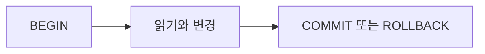

<!-- level:1 -->
# 트랜잭션과 격리 — 함께 성공해야 하는 변경

송금은 출금과 입금이 함께 성공해야 한다. 트랜잭션은 여러 연산을 하나의 완료 경계로 묶는다. ACID의 원자성·일관성·격리성·지속성은 서로 다른 질문에 답한다. 일관성은 업무 불변식과 DB 제약을 올바르게 설계했다는 전제를 포함하며 DB가 모든 업무 규칙을 알아서 만들어 주지는 않는다.



동시에 실행되는 트랜잭션은 서로의 변경을 어떤 시점에 보는지에 따라 결과가 달라질 수 있다. dirty read, nonrepeatable read, phantom, serialization anomaly를 구분한다. 높은 격리에는 대기·충돌·재시도 비용이 생길 수 있다.

**비유의 한계:** 격리는 모든 쿼리를 실제로 한 줄씩 직렬 실행한다는 뜻이 아니다. MVCC는 여러 버전과 스냅샷으로 동시성을 제공할 수 있다.
<!-- level:2 -->
# PostgreSQL 17의 스냅샷과 충돌

Read Committed는 일반적으로 문장별 스냅샷을 사용한다. PostgreSQL의 Read Uncommitted는 Read Committed처럼 동작한다. Repeatable Read는 안정된 스냅샷을 제공하고 PostgreSQL에서는 phantom도 방지하지만 모든 serialization anomaly를 막지는 않는다. Serializable은 충돌을 감지해 일부 트랜잭션을 실패시키므로 앱이 전체 트랜잭션을 재시도해야 한다.

학습용 테이블을 두 SQL 세션에서 준비한다.

```sql
CREATE TABLE inventory_lab(id integer PRIMARY KEY, stock integer CHECK(stock>=0));
INSERT INTO inventory_lab VALUES(1,1);
-- 각 세션에서 실행: 확인과 차감을 한 문장으로 연결
BEGIN;
UPDATE inventory_lab SET stock=stock-1 WHERE id=1 AND stock>0
RETURNING stock;
COMMIT;
```

반환 행 0개는 재고 확보 실패로 처리한다. 앱에서 SELECT 후 조건 없는 UPDATE를 하면 경쟁을 놓칠 수 있다. 행 잠금은 충돌하는 변경을 직렬화하는 도구이고, 여러 행의 업무 규칙에는 명시적 잠금·제약·Serializable 등의 검토가 필요하다.
<!-- level:3 -->
# 가상 장애 — 재시도했는데 외부 알림이 두 번 갔다

가상 Serializable 작업이 충돌로 rollback되어 다시 실행됐다. 트랜잭션 안에서 이미 발송한 이메일은 DB rollback으로 취소되지 않는다. `40001` 같은 serialization 실패와 업무 중복을 함께 조사한다.

**수정:** 재시도는 전체 트랜잭션을 새로 시작하고 횟수·지터·기한을 제한한다. 외부 효과는 commit 이후 또는 outbox로 연결하고 소비자의 멱등성을 설계한다. deadlock 오류와 serialization 실패를 무조건 같은 원인으로 설명하지 않는다.

**재검증:** 동시 차감, 충돌, commit 후 응답 손실, 재시도 실패를 재현한다. 재고 불변식·중복 효과·트랜잭션 지연·실패율을 확인한다. 긴 트랜잭션과 잠금 획득 순서도 개선한다.
<!-- level:4 -->
# 격리 수준과 업무 규칙의 선택

| 접근 | 이득 | 비용 |
|---|---|---|
| Read Committed + 원자 문장·제약 | 흔한 단일 행 변경에 효율적 | 복합 불변식 검토 |
| 명시적 행 잠금 | 충돌 변경 경계 명확 | 대기·deadlock·긴 보유 |
| Serializable | 직렬 실행과 같은 결과 계약 | abort와 전체 재시도 |

격리 수준만 올려 외부 시스템의 원자성을 얻을 수는 없다. DB 연결 풀, 트랜잭션 길이, 핫키, 잠금 순서, 재시도 폭주를 함께 설계한다. DB 제품별 실제 격리 보장은 같은 이름이어도 다를 수 있어 프로젝트 버전 문서로 확인한다.

**판단 연습:** 한 상품 재고와 서로 다른 의사 두 명의 근무 규칙을 같은 조건 UPDATE만으로 보장할까? 읽기 집합과 불변식을 먼저 정하자.

참고: [PostgreSQL 17 Isolation](https://www.postgresql.org/docs/17/transaction-iso.html), [Explicit Locking](https://www.postgresql.org/docs/17/explicit-locking.html).
<!-- quizzes -->
[{"level":1,"question":"DB 트랜잭션의 rollback이 직접 취소하지 못하는 것은?","choices":["그 트랜잭션의 미커밋 행 변경","이미 외부로 발송한 이메일","해당 DB 쓰기","DB 내부 원자 작업"],"answer_index":1,"explanation":"외부 시스템의 효과는 DB rollback 경계 밖입니다. outbox·commit 후 처리·멱등성 등 연결 계약이 필요합니다."},{"level":2,"question":"PostgreSQL Repeatable Read에 대한 정확한 설명은?","choices":["모든 serialization anomaly 방지","dirty read 허용","안정 스냅샷과 phantom 방지를 제공하지만 직렬성은 별도","문장마다 항상 새 스냅샷"],"answer_index":2,"explanation":"PostgreSQL 구현은 phantom을 방지하지만 snapshot isolation의 직렬성 이상은 남을 수 있습니다. Serializable과 구분합니다."},{"level":3,"question":"serialization 실패 후 올바른 재시도는?","choices":["전체 트랜잭션을 새로 제한된 정책으로 재시도","실패한 마지막 SQL만 항상 반복","외부 효과를 무제한 중복 실행","오류를 성공 처리"],"answer_index":0,"explanation":"새 스냅샷으로 전체 업무를 다시 실행해야 합니다. 횟수·기한·외부 부작용의 멱등성을 함께 제어합니다."},{"level":4,"question":"격리 수준을 선택하는 핵심 기준은?","choices":["항상 가장 약한 수준","제품 이름만","모든 업무에 똑같은 수준","보호할 불변식·읽기 집합·충돌과 재시도 비용"],"answer_index":3,"explanation":"업무 규칙이 어떤 동시 실행을 허용하는지 정의하고 실제 보장과 운영 비용을 비교해야 합니다."}]
