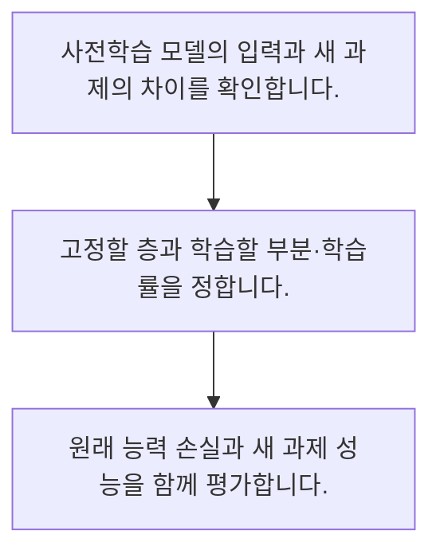

<!-- level:1 -->
# 전이 학습·동결·미세조정

> **한 문장으로:** 이미 학습한 표현을 새 과제에 활용하되 무엇을 고정하고 바꿀지와 자료 적합성을 선택합니다.

## 왜 필요한가요?

학습 대상 크기를 세는 구조 예제입니다. 인코더를 고정하고 출력 헤드 20개만 갱신한다고 가정합니다. 실제 프레임워크에서는 미분·옵티마이저·평가 모드 설정도 맞춰야 합니다.

## 일상에서 떠올려 보기

기본 운전 기술을 익힌 사람이 다른 차의 조작을 배우는 것과 비슷합니다. 공통 기술을 활용할 수 있지만 새 환경의 차이를 따로 확인해야 합니다.

## 순서대로 따라가기

1. 사전학습 모델의 입력과 새 과제의 차이를 확인합니다.
2. 고정할 층과 학습할 부분·학습률을 정합니다.
3. 원래 능력 손실과 새 과제 성능을 함께 평가합니다.



## 처음 만나는 용어

| 용어 | 쉬운 뜻 |
|---|---|
| 사전학습 | 여러 과제에 쓸 표현을 미리 학습하는 과정 |
| 동결 | 선택한 파라미터의 학습 갱신을 막는 상태 |
| 미세조정 | 새 자료와 목표로 모델 일부나 전체를 추가 학습하는 과정 |

**비유의 한계:** 사전학습 모델의 성능이 모든 분야에 그대로 이전되지는 않습니다. 라이선스·자료 차이·평가 누출과 편향을 함께 확인해야 합니다.

## 스스로 확인

동결의 의미는 무엇인가요?

**답과 이유:** 선택한 파라미터 갱신 제한 — 동결된 부분도 순전파에 사용될 수 있지만 학습 갱신은 제한됩니다.
<!-- level:2 -->
# 전이 학습·동결·미세조정 — 실제 흐름 따라가기

## 읽기 전 길잡이

이미 학습한 표현을 새 과제에 활용하되 무엇을 고정하고 바꿀지와 자료 적합성을 선택합니다. 아래 예제는 외부 시스템에 연결하지 않는 작은 학습용 사례입니다. 입력, 처리 조건, 결과를 순서대로 살펴보세요.

1. 사전학습 모델의 입력과 새 과제의 차이를 확인합니다.
2. 고정할 층과 학습할 부분·학습률을 정합니다.
3. 원래 능력 손실과 새 과제 성능을 함께 평가합니다.

## 예제로 확인하기

```python
parameters={"encoder":1000,"head":20}
trainable={"encoder":False,"head":True}
count=sum(n for name,n in parameters.items() if trainable[name])
assert count==20
print("학습 대상 수:",count)
```

## 결과를 해석하기

학습 대상 크기를 세는 구조 예제입니다. 인코더를 고정하고 출력 헤드 20개만 갱신한다고 가정합니다. 실제 프레임워크에서는 미분·옵티마이저·평가 모드 설정도 맞춰야 합니다.

## 실무에 옮기기 전

사전학습 모델의 성능이 모든 분야에 그대로 이전되지는 않습니다. 라이선스·자료 차이·평가 누출과 편향을 함께 확인해야 합니다. 실제 업무에서는 사용 가능한 자료량과 계산 예산, 보존해야 할 능력을 기준으로 변경 범위를 정합니다. 품질 향상뿐 아니라 배포·되돌리기와 라이선스 조건도 확인합니다.

## 확인 질문

예제에서 학습 대상 파라미터 수는?

**답과 이유:** 헤드만 학습 대상으로 표시되어 있습니다.
<!-- level:3 -->
# 전이 학습·동결·미세조정 — 가상 사례로 문제 해결하기

실제 고객의 장애 기록이 아닌 학습용 재현 시나리오입니다. 결과만 바꾸기 전에 관측한 증거와 원인 가설을 구분합니다.

## 1. 어떤 문제가 생겼나요?

가상 미세조정 모델이 새 자료는 잘 맞히지만 기존 과제에서 크게 나빠집니다.

## 2. 먼저 확인할 증거

이전·새 평가 세트와 학습률·학습 대상 층을 비교합니다.

## 3. 원인 가설

적은 새 자료에 강하게 맞추며 기존 표현을 손상했습니다.

## 4. 수정 방법

동결 범위·학습률·자료 혼합과 조기 종료를 검토합니다.

## 5. 재검증

새 과제와 보존할 능력의 회귀 평가를 함께 수행합니다.

## 놓치기 쉬운 조건

사전학습 모델의 성능이 모든 분야에 그대로 이전되지는 않습니다. 라이선스·자료 차이·평가 누출과 편향을 함께 확인해야 합니다.

## 확인 질문

미세조정 후 기존 능력이 나빠지면?

**답과 이유:** 적응 과정에서 보존할 능력이 손상됐는지 함께 평가해야 합니다.
<!-- level:4 -->
# 전이 학습·동결·미세조정 — 업무와 아키텍처의 선택

## 읽기 전 길잡이

같은 개념도 업무의 규모, 오류 비용, 운영 역량에 따라 적용 방식이 달라집니다. 아래 비교는 특정 제품의 성능 순위가 아닌 선택 기준입니다.

| 선택 | 얻는 점 | 감수할 점 |
|---|---|---|
| 특징 추출·헤드 학습 | 학습 비용·변경 범위 감소 | 도메인 적응 제한 |
| 전체 미세조정 | 적응 자유도 증가 | 메모리·과적합·능력 손실 위험 |

## 선택 기준

사용 가능한 자료량과 계산 예산, 보존해야 할 능력을 기준으로 변경 범위를 정합니다. 품질 향상뿐 아니라 배포·되돌리기와 라이선스 조건도 확인합니다.

## 도입과 운영에서 확인할 것

동결 범위·학습률·자료 혼합과 조기 종료를 검토합니다. 새 과제와 보존할 능력의 회귀 평가를 함께 수행합니다.

## 판단 연습

전체 미세조정 선택 시 비용은?

**판단의 근거:** 변경 자유도에는 더 큰 학습과 운영 책임이 따릅니다.

참고: [PyTorch 기초](https://docs.pytorch.org/tutorials/beginner/basics/intro.html), [Attention Is All You Need](https://arxiv.org/abs/1706.03762), [DDPM 논문](https://arxiv.org/abs/2006.11239).
<!-- quizzes -->
[{"level":1,"question":"동결의 의미는 무엇인가요?","choices":["모델 파일 삭제","입력 차단","항상 추론 중단","선택한 파라미터 갱신 제한"],"answer_index":3,"explanation":"동결된 부분도 순전파에 사용될 수 있지만 학습 갱신은 제한됩니다."},{"level":2,"question":"예제에서 학습 대상 파라미터 수는?","choices":["20","1000","1020","0"],"answer_index":0,"explanation":"헤드만 학습 대상으로 표시되어 있습니다."},{"level":3,"question":"미세조정 후 기존 능력이 나빠지면?","choices":["학습률 무한 증가","회귀 평가와 학습 범위 확인","새 과제만 보기","기존 테스트 삭제"],"answer_index":1,"explanation":"적응 과정에서 보존할 능력이 손상됐는지 함께 평가해야 합니다."},{"level":4,"question":"전체 미세조정 선택 시 비용은?","choices":["자료 검증 불필요","라이선스 무관","메모리·과적합·능력 손실","항상 무료"],"answer_index":2,"explanation":"변경 자유도에는 더 큰 학습과 운영 책임이 따릅니다."}]
