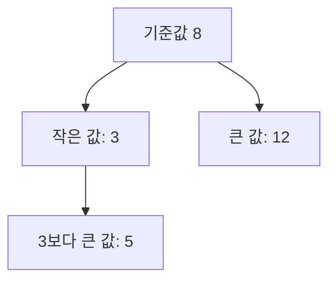

<!-- level:1 -->
# 트리와 이진 탐색 트리 — 질문을 따라 후보 줄이기

> **한 문장으로:** 작거나 큰 값을 구분하며 내려가는 구조를 사용하면 찾을 후보를 단계적으로 줄일 수 있습니다.

## 왜 필요한가요?

많은 자료를 찾거나 순서대로 정리할 때 매번 모든 항목을 보고 싶지 않습니다. 비교 결과로 다음에 볼 위치를 결정하는 구조가 필요합니다.

## 일상에서 떠올려 보기

스무고개에서 ‘50보다 작은가?’라는 질문으로 후보를 줄인다고 생각해 보세요. 이진 탐색 트리에서는 현재 값보다 작으면 왼쪽, 크면 오른쪽으로 내려갑니다. 각 갈림길에 비교 규칙이 있습니다.

## 순서대로 따라가기

1. 맨 위의 값과 찾는 값을 비교합니다.
2. 작으면 왼쪽 자식, 크면 오른쪽 자식으로 이동합니다.
3. 값을 찾거나 더 내려갈 곳이 없을 때 멈춥니다. 규칙에 맞게 저장되어 있어야 이 방법이 작동합니다.



## 작은 예로 확인하기

위 그림에서 5를 찾으면 8보다 작으므로 왼쪽 3으로, 3보다 크므로 그 오른쪽 5로 갑니다. 자식이 최대 두 개인 구조를 이진 트리라고 부르고, 여기에 작은 값·큰 값의 순서 규칙까지 갖춘 것이 이진 탐색 트리입니다.

## 처음 만나는 용어

| 용어 | 쉬운 뜻 |
|---|---|
| 트리 | 위아래 관계로 자료를 연결한 구조입니다. |
| 루트 | 트리의 시작이 되는 맨 위 원소입니다. |
| 자식 노드 | 현재 원소에서 아래로 연결된 원소입니다. |
| BST | 작은 값과 큰 값의 순서 규칙을 가진 이진 탐색 트리입니다. |

**비유의 한계:** 매번 후보가 절반으로 줄어드는 것은 균형이 잘 유지될 때의 직관입니다. 한쪽으로만 길게 이어진 트리는 목록처럼 많은 값을 확인해야 할 수 있습니다.

## 스스로 확인

자식이 두 개 이하라는 사실만으로 이진 탐색 트리라고 할 수 있을까요?

**답과 이유:** 아닙니다. 값의 순서 규칙도 필요합니다. 그 규칙이 있어야 비교 결과로 왼쪽과 오른쪽 중 어디를 찾을지 결정할 수 있습니다.
<!-- level:2 -->
# 탐색 비용은 높이에 비례한다

<!-- beginner-guide:start -->
## 읽기 전 길잡이

검색 예제의 비교와 다음 노드 선택을 따라가세요. 높이가 짧으면 비교 단계가 줄고, 한쪽으로 길면 단계가 늘어난다는 점을 실제 값으로 확인합니다.

## 이 단계에서 만날 말

| 용어 | 쉬운 뜻 |
|---|---|
| 높이 | 루트에서 아래까지 이어지는 경로의 길이와 관련된 값입니다. |
| 균형 | 특정 방향으로 깊이가 지나치게 몰리지 않는 성질입니다. |
| 중위 순회 | 왼쪽 부분, 현재 값, 오른쪽 부분 순서로 방문하는 방법입니다. |
| 편향 트리 | 원소가 한쪽으로 길게 이어진 트리입니다. |
| 후계자·전임자 | 정렬 순서에서 바로 다음 값과 바로 이전 값입니다. |
| O(log n)·O(n) | 후보를 반복해 줄이는 비용과 모든 원소만큼 늘어날 수 있는 비용입니다. |

<!-- beginner-guide:end -->

BST 검색은 키 비교 후 왼쪽·오른쪽 자식으로 진행한다. 높이 h의 검색 비용은 O(h)이고 균형을 보장하면 h가 O(log n), 편향되면 O(n)이다. 중위 순회는 BST의 순서 규칙이 유지될 때 정렬 순서를 만든다. 삭제는 자식 수에 따라 연결을 바꾸거나 후계자/전임자를 선택한다.

Python 3의 교육용 검색 예제다.

```python
tree = {8: (3, 12), 3: (1, 5), 12: (None, None),
        1: (None, None), 5: (None, None)}
def contains(key):
    current = 8
    while current is not None:
        if key == current: return True
        current = tree[current][0 if key < current else 1]
    return False
assert contains(5) and not contains(7)
```

이 코드는 삽입·삭제·균형을 구현한 컨테이너가 아니다. AVL·red-black tree는 회전과 균형 불변식으로 높이를 제한한다. 균형 유지 작업은 수정 비용에 추가된다. 비교 함수가 일관된 순서를 제공하지 않거나 키를 저장 후 변경하면 탐색 규칙이 무너질 수 있다.
<!-- level:3 -->
# 재현 사례 — sorted 입력에서만 검색이 느리다

<!-- beginner-guide:start -->
## 읽기 전 길잡이

정렬된 값을 그대로 넣어 트리가 한쪽으로 길어지는 사례를 봅니다. 원소 수만 보지 말고 트리의 높이와 삽입 순서도 확인하세요.

<!-- beginner-guide:end -->

가상 단순 BST 구현이 무작위 입력에서는 빨랐지만 정렬된 입력에서 높이가 n에 가까워졌다. 탐색 지연만 보지 말고 트리 높이·삽입 순서·노드별 깊이를 확인한다. 재귀 구현에서는 스택 깊이 한도도 실패 원인이 될 수 있다.

**수정:** 최악 경계가 필요하면 검증된 균형 트리 구현을 사용한다. 읽기 위주라면 정렬 배열과 이진 탐색도 비교한다. 단순히 입력을 섞는 것은 최악 보장이 아니며 데이터 의미를 바꿀 수 있다.

**재검증:** 오름차순·내림차순·중복·랜덤 키에 대해 삽입·탐색·삭제 후 순서 불변식을 확인한다. 모든 키가 한 번씩 존재하는지, 높이와 지연이 입력 증가에 따라 어떻게 변하는지 검사한다.
<!-- level:4 -->
# 순서 자료구조 선택하기

<!-- beginner-guide:start -->
## 읽기 전 길잡이

항상 빠른 검색이 필요한지, 삽입과 삭제가 얼마나 많은지에 따라 균형 유지 비용을 감수할지 결정합니다. 저장장치용 B-Tree는 또 다른 접근 비용을 고려한다는 점도 이어서 읽으세요.

<!-- beginner-guide:end -->

| 구조 | 적합한 용도 | 비용 |
|---|---|---|
| 균형 BST | 자주 변경되는 정렬 키 | 포인터·회전·비교 비용 |
| 정렬 배열 | 읽기 위주 범위·검색 | 중간 갱신 비용 |
| B-Tree 계열 | 페이지 기반 저장·범위 스캔 | 페이지 분할·쓰기 증폭 |

CPU 메모리에서의 균형 트리와 DB 페이지 기반 B-Tree는 같은 모양의 구조가 아니다. 디스크/페이지 접근에서는 분기 수를 늘려 높이를 낮추는 설계가 유리할 수 있다. 요구되는 정렬·범위·갱신·메모리·동시성을 명시한다.

**판단 연습:** 매분 전체를 다시 만드는 작은 상품 가격 목록과 매초 삽입되는 대형 시간 인덱스는 어떤 구조를 비교할까? 최악 지연과 갱신 비용을 근거로 답하자.

참고: [Princeton BST](https://algs4.cs.princeton.edu/32bst/), [Princeton Balanced Trees](https://algs4.cs.princeton.edu/33balanced/).
<!-- quizzes -->
[{"level":1,"question":"BST와 이진 트리를 구분한 설명은?","choices":["모든 이진 트리는 BST","BST에는 키 순서 규칙이 추가됨","BST는 자식이 무한 개","이진 트리는 정렬 배열"],"answer_index":1,"explanation":"이진 트리는 자식 수 조건이고 BST는 키의 왼쪽·오른쪽 순서 규칙을 추가합니다. 균형 조건은 별도로 필요합니다."},{"level":2,"question":"단순 BST 검색의 비용을 직접 좌우하는 것은?","choices":["파일 크기만","모든 노드의 제목","트리 높이 h","항상 고정 1회 비교"],"answer_index":2,"explanation":"검색은 경로를 따라 비교하므로 O(h)입니다. 균형이 없으면 높이가 n으로 커질 수 있습니다."},{"level":3,"question":"정렬된 입력에서 BST가 느려지면 적절한 조사와 수정은?","choices":["높이를 확인하고 균형 트리·정렬 배열 대안을 비교","무조건 재귀 한도만 증가","입력 정렬 의미 삭제","모든 실패 무시"],"answer_index":0,"explanation":"편향은 탐색 경로를 길게 만듭니다. 최악 지연 요구에 맞는 구조와 갱신 비용을 선택해야 합니다."},{"level":4,"question":"DB에서 B-Tree 계열을 쓰는 중요한 이유는?","choices":["페이지 접근이 공짜","항상 자식 둘만 사용","모든 쓰기를 없앰","페이지 단위 분기와 정렬 탐색으로 I/O 경로를 효율화"],"answer_index":3,"explanation":"페이지에 많은 키를 담아 높이를 줄이고 범위 탐색에 활용합니다. 페이지 분할과 쓰기 비용도 함께 고려합니다."}]
