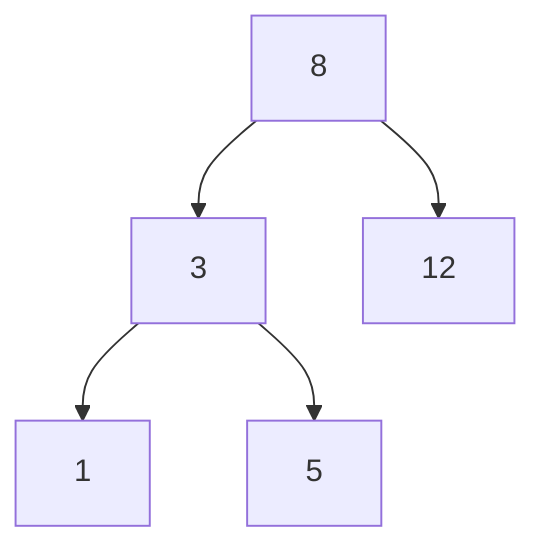

<!-- level:1 -->
# 트리와 BST — 질문으로 후보를 줄이는 구조

가족 계보처럼 노드가 부모·자식 관계로 이어진 구조가 트리다. 이진 탐색 트리(BST)는 한 노드의 왼쪽에는 더 작은 키, 오른쪽에는 더 큰 키를 놓는 순서 규칙을 사용한다. “찾는 값이 더 작은가?”라는 질문으로 탐색할 쪽을 줄인다.



높이는 뿌리에서 가장 깊은 노드까지의 경로 길이와 관련된다. 균형이 잘 잡혀 있으면 탐색 경로가 짧지만 한쪽으로 기울면 연결 리스트처럼 길어진다. “이진 트리”는 자식이 최대 둘이라는 조건이고 모든 이진 트리가 BST인 것은 아니다.

**비유의 한계:** 작은 쪽을 고른다고 매번 정확히 절반이 줄어드는 것은 아니다. 삽입 순서와 균형 정책이 중요하다. 중복 키의 위치와 비교 규칙도 계약에 포함된다.

**확인:** 정렬된 숫자를 단순 BST에 차례로 넣으면 어떤 모양이 되는가?
<!-- level:2 -->
# 탐색 비용은 높이에 비례한다

BST 검색은 키 비교 후 왼쪽·오른쪽 자식으로 진행한다. 높이 h의 검색 비용은 O(h)이고 균형을 보장하면 h가 O(log n), 편향되면 O(n)이다. 중위 순회는 BST의 순서 규칙이 유지될 때 정렬 순서를 만든다. 삭제는 자식 수에 따라 연결을 바꾸거나 후계자/전임자를 선택한다.

Python 3의 교육용 검색 예제다.

```python
tree = {8: (3, 12), 3: (1, 5), 12: (None, None),
        1: (None, None), 5: (None, None)}
def contains(key):
    current = 8
    while current is not None:
        if key == current: return True
        current = tree[current][0 if key < current else 1]
    return False
assert contains(5) and not contains(7)
```

이 코드는 삽입·삭제·균형을 구현한 컨테이너가 아니다. AVL·red-black tree는 회전과 균형 불변식으로 높이를 제한한다. 균형 유지 작업은 수정 비용에 추가된다. 비교 함수가 일관된 순서를 제공하지 않거나 키를 저장 후 변경하면 탐색 규칙이 무너질 수 있다.
<!-- level:3 -->
# 재현 사례 — sorted 입력에서만 검색이 느리다

가상 단순 BST 구현이 무작위 입력에서는 빨랐지만 정렬된 입력에서 높이가 n에 가까워졌다. 탐색 지연만 보지 말고 트리 높이·삽입 순서·노드별 깊이를 확인한다. 재귀 구현에서는 스택 깊이 한도도 실패 원인이 될 수 있다.

**수정:** 최악 경계가 필요하면 검증된 균형 트리 구현을 사용한다. 읽기 위주라면 정렬 배열과 이진 탐색도 비교한다. 단순히 입력을 섞는 것은 최악 보장이 아니며 데이터 의미를 바꿀 수 있다.

**재검증:** 오름차순·내림차순·중복·랜덤 키에 대해 삽입·탐색·삭제 후 순서 불변식을 확인한다. 모든 키가 한 번씩 존재하는지, 높이와 지연이 입력 증가에 따라 어떻게 변하는지 검사한다.
<!-- level:4 -->
# 순서 자료구조 선택하기

| 구조 | 적합한 용도 | 비용 |
|---|---|---|
| 균형 BST | 자주 변경되는 정렬 키 | 포인터·회전·비교 비용 |
| 정렬 배열 | 읽기 위주 범위·검색 | 중간 갱신 비용 |
| B-Tree 계열 | 페이지 기반 저장·범위 스캔 | 페이지 분할·쓰기 증폭 |

CPU 메모리에서의 균형 트리와 DB 페이지 기반 B-Tree는 같은 모양의 구조가 아니다. 디스크/페이지 접근에서는 분기 수를 늘려 높이를 낮추는 설계가 유리할 수 있다. 요구되는 정렬·범위·갱신·메모리·동시성을 명시한다.

**판단 연습:** 매분 전체를 다시 만드는 작은 상품 가격 목록과 매초 삽입되는 대형 시간 인덱스는 어떤 구조를 비교할까? 최악 지연과 갱신 비용을 근거로 답하자.

참고: [Princeton BST](https://algs4.cs.princeton.edu/32bst/), [Princeton Balanced Trees](https://algs4.cs.princeton.edu/33balanced/).
<!-- quizzes -->
[{"level":1,"question":"BST와 이진 트리를 구분한 설명은?","choices":["모든 이진 트리는 BST","BST에는 키 순서 규칙이 추가됨","BST는 자식이 무한 개","이진 트리는 정렬 배열"],"answer_index":1,"explanation":"이진 트리는 자식 수 조건이고 BST는 키의 왼쪽·오른쪽 순서 규칙을 추가합니다. 균형 조건은 별도로 필요합니다."},{"level":2,"question":"단순 BST 검색의 비용을 직접 좌우하는 것은?","choices":["파일 크기만","모든 노드의 제목","트리 높이 h","항상 고정 1회 비교"],"answer_index":2,"explanation":"검색은 경로를 따라 비교하므로 O(h)입니다. 균형이 없으면 높이가 n으로 커질 수 있습니다."},{"level":3,"question":"정렬된 입력에서 BST가 느려지면 적절한 조사와 수정은?","choices":["높이를 확인하고 균형 트리·정렬 배열 대안을 비교","무조건 재귀 한도만 증가","입력 정렬 의미 삭제","모든 실패 무시"],"answer_index":0,"explanation":"편향은 탐색 경로를 길게 만듭니다. 최악 지연 요구에 맞는 구조와 갱신 비용을 선택해야 합니다."},{"level":4,"question":"DB에서 B-Tree 계열을 쓰는 중요한 이유는?","choices":["페이지 접근이 공짜","항상 자식 둘만 사용","모든 쓰기를 없앰","페이지 단위 분기와 정렬 탐색으로 I/O 경로를 효율화"],"answer_index":3,"explanation":"페이지에 많은 키를 담아 높이를 줄이고 범위 탐색에 활용합니다. 페이지 분할과 쓰기 비용도 함께 고려합니다."}]
