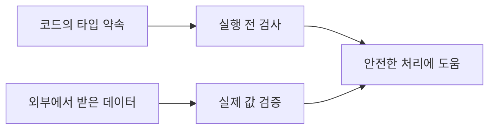

<!-- level:1 -->
# 타입 시스템 — 값의 모양과 사용 규칙 확인하기

> **한 문장으로:** 타입은 값에 어떤 형태와 작업이 허용되는지 설명하고, 잘못된 조합을 찾도록 돕습니다.

## 왜 필요한가요?

가격에 글자를 더하거나 없는 필드를 읽으면 프로그램이 실패할 수 있습니다. 값의 종류와 상태를 명확히 표현하면 이런 실수를 더 일찍 찾기 쉽습니다.

## 일상에서 떠올려 보기

신청서에서 나이는 숫자, 연락처는 문자열, 동의 여부는 체크 표시로 받는다고 생각해 보세요. 설계할 때 칸의 종류를 확인하는 일과 실제 제출된 내용이 맞는지 검사하는 일은 구분해야 합니다.

## 순서대로 따라가기

1. 숫자·문자열·상태처럼 값에 기대하는 형태를 정의합니다.
2. 정적 타입 검사는 실행 전에 코드의 사용 관계를 확인하고, 동적 타입 환경은 실행 중 값의 종류를 다룹니다.
3. 외부에서 들어온 실제 데이터는 별도로 검사해 코드가 기대하는 조건을 만족하는지 확인합니다.



## 작은 예로 확인하기

API에서 age가 숫자라고 선언했어도 실제 응답이 ‘스물’이라는 문자열일 수 있습니다. TypeScript의 선언만으로 외부 응답이 바뀌지는 않습니다. 실제 값이 숫자인지, 허용 범위인지 확인한 뒤 사용해야 합니다.

## 처음 만나는 용어

| 용어 | 쉬운 뜻 |
|---|---|
| 타입 | 값의 형태와 허용되는 사용 규칙을 나타내는 정보입니다. |
| 정적 타입 검사 | 프로그램을 실행하기 전에 코드의 타입 관계를 확인하는 것입니다. |
| 동적 타입 | 실행 중 값의 종류를 다루는 타입 방식입니다. |
| 런타임 검증 | 실제로 들어온 값이 조건에 맞는지 실행 중 확인하는 것입니다. |

**비유의 한계:** 타입 검사가 모든 업무 오류와 보안 문제를 막지는 않습니다. 숫자 타입인 잔액이 잘못 계산되거나 허용 범위를 넘을 수 있으며 외부 입력의 검증도 필요합니다.

## 스스로 확인

코드에서 API 응답 타입을 선언했으면 서버가 잘못 보낸 값도 자동으로 고쳐질까요?

**답과 이유:** 아닙니다. 선언은 기대를 표현합니다. 외부 데이터가 실제로 그 구조와 범위를 만족하는지 별도로 검증해야 합니다.
<!-- level:2 -->
# narrowing과 런타임 경계

<!-- beginner-guide:start -->
## 읽기 전 길잡이

예제는 성공과 실패 상태를 구별해 각 상태에서 쓸 수 있는 값을 다르게 표현합니다. 분기를 통과한 뒤 어떤 값이 있다고 확신할 수 있는지 보세요.

## 이 단계에서 만날 말

| 용어 | 쉬운 뜻 |
|---|---|
| 유니언 타입 | 값이 여러 형태 중 하나일 수 있음을 표현하는 타입입니다. |
| narrowing | 조건 검사로 가능한 타입의 범위를 좁히는 것입니다. |
| 태그 | 현재 값이 어떤 상태·종류인지 구별하는 표시입니다. |
| null | 값이 없음을 나타내는 특별한 값입니다. |
| 스키마 | 데이터의 필드·종류·조건을 정의한 규격입니다. |
| 타입 소거 | 일부 타입 정보가 실행 코드에서는 남지 않는 성질입니다. |

<!-- beginner-guide:end -->

유니언 타입은 여러 가능성을, 태그가 있는 유니언은 상태별 유효 필드를 표현한다. 검사기는 분기에서 타입을 좁힐 수 있다. null 가능성과 오류 상태를 계약에 포함하면 누락된 경로를 발견하기 쉽다.

TypeScript 예제는 `tsc` 검사 또는 tsx 실행이 필요하다.

```typescript
type Result = { ok: true; value: number } | { ok: false; error: string };
function parseCount(input: unknown): Result {
  if (typeof input !== "number" || !Number.isInteger(input) || input < 0)
    return { ok: false, error: "nonnegative integer required" };
  return { ok: true, value: input };
}
const result = parseCount(3);
if (result.ok) console.log(result.value + 1); // 4
else console.log(result.error);
```

TypeScript 타입은 일반적으로 실행 JS에서 지워지므로 `as SomeType`은 데이터 변환·검증이 아니다. Zod 같은 런타임 스키마는 실제 값을 확인할 수 있지만 업무 관계 전체를 자동 검증하는 것도 아니다. 정적·동적은 검사 시점이고 strong/weak 같은 비공식 분류와 동일 축이 아니다.
<!-- level:3 -->
# 가상 장애 — 타입 단언 뒤 런타임에서 필드가 없다

<!-- beginner-guide:start -->
## 읽기 전 길잡이

개발 중 검사는 통과했는데 운영 데이터에서 실패한 사례를 봅니다. 외부 경계에 타입 선언만 있었는지, 실제 값 검증과 오류 처리가 있었는지 확인하세요.

<!-- beginner-guide:end -->

가상 API 코드가 `await response.json() as User`로 받아 이메일 문자열을 바로 사용한다. 실제 응답은 오류 객체여서 실패한다. 컴파일러가 외부 응답을 검사한 것이 아니라 개발자가 검사를 건너뛴 것이다.

**진단:** HTTP 상태·콘텐츠 타입·응답 스키마·버전과 실제 필드의 경계 조건을 확인한다. 민감한 사용자 응답 전체를 로그에 남기지 않는다. 성공 응답 fixture만으로 테스트하면 오류·null·빈 값 경로를 놓친다.

**수정:** 외부 경계에서 unknown으로 받아 스키마를 검증하고 성공·실패 상태를 구분한다. 타입 단언과 any를 최소화하고 엄격한 null 검사를 활성화한다. DB 제약과 입력 검증은 서로 보완한다.

**재검증:** 필드 누락·잘못된 타입·추가 필드·경계 숫자·호환 버전을 검사한다. 과도한 엄격성이 합법적인 확장 필드를 거절하는지도 계약에 맞춰 판단한다.
<!-- level:4 -->
# 계약의 표현력과 변경 비용

<!-- beginner-guide:start -->
## 읽기 전 길잡이

타입을 자세히 표현하면 검증과 변경 추적이 쉬워질 수 있지만 규격 관리 비용도 있습니다. 여러 서비스의 데이터 약속과 실행 중 검증 범위를 함께 설계하세요.

<!-- beginner-guide:end -->

| 방식 | 이득 | 한계 |
|---|---|---|
| 정적 타입 | 개발 중 계약 오류 발견 | 외부 값·업무 진실성은 별도 |
| 런타임 스키마 | 입력 구조·범위 확인 | 검증 비용·버전 관리 |
| DB 제약 | 저장된 상태의 규칙 보호 | 앱 오류 설명·이행 설계 |

크고 오래가는 코드베이스에서는 타입이 리팩터링 안전망이 될 수 있지만 무리한 제네릭·단언은 가독성을 해칠 수 있다. 동적 언어에서도 명확한 계약·테스트·검증은 중요하다. 네트워크 경계의 타입 생성은 원천 스키마와 버전 이행 정책을 함께 관리한다.

**판단 연습:** 새 필드를 추가하는 API에서 구버전 클라이언트와 DB 제약을 어떻게 유지할까? optional, default, 버전, 런타임 검증의 책임을 나눠 설명하자.

참고: [TypeScript Narrowing](https://www.typescriptlang.org/docs/handbook/2/narrowing.html), [TypeScript Everyday Types](https://www.typescriptlang.org/docs/handbook/2/everyday-types.html).
<!-- quizzes -->
[{"level":1,"question":"정적 타입이 있는 API 코드에도 런타임 검증이 필요한 이유는?","choices":["모든 타입은 암호화","외부 데이터가 선언한 구조를 실제로 만족하는지 별도 확인 필요","컴파일러는 HTTP 내용을 항상 미리 조회","JSON에는 오류가 없음"],"answer_index":1,"explanation":"외부 값은 실행 시점에 들어옵니다. 정적 선언만으로 실제 JSON의 구조·범위가 검증되지는 않습니다."},{"level":2,"question":"TypeScript의 as User 단언이 하는 일은?","choices":["데이터를 자동 변환","HTTP 상태 검증","컴파일러에게 타입 해석을 알리며 런타임 검사하지 않음","DB에 제약 자동 생성"],"answer_index":2,"explanation":"타입 단언은 실제 검증이 아닙니다. 신뢰하지 않는 값은 unknown으로 받아 런타임 스키마 등으로 확인해야 합니다."},{"level":3,"question":"외부 응답 필드 누락 장애의 개선 출발점은?","choices":["경계에서 상태·스키마 검증과 오류 경로 테스트","any를 모든 곳에 사용","응답 로그를 민감 정보째 공개","성공 fixture만 유지"],"answer_index":0,"explanation":"외부 계약 실패를 분리하고 누락·null·잘못된 타입을 검증해야 합니다. 민감 데이터 로그는 최소화합니다."},{"level":4,"question":"정적 타입·런타임 검증·DB 제약의 관계는?","choices":["하나가 있으면 나머지 모두 불필요","같은 검사 시점","전부 인가를 자동 보장","서로 다른 경계의 규칙을 보완"],"answer_index":3,"explanation":"개발 단계·입력 단계·저장 단계의 보호 범위가 다릅니다. 업무 불변식과 인가도 별도 설계가 필요합니다."}]
