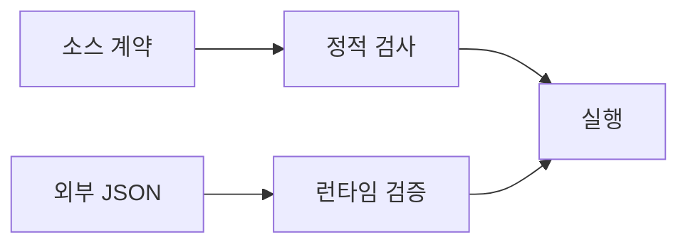

<!-- level:1 -->
# 타입 시스템 — 값의 사용 규칙을 확인하는 시점

물건 상자에 “깨지기 쉬움”이라는 표시를 하면 다루는 규칙을 알 수 있다. 타입은 값에 허용되는 연산과 프로그램 계약을 표현한다. 정적 타입 검사는 실행 전에 일부 오류를 찾고, 동적 타입 검사는 실행 중 값에 대한 연산의 적합성을 확인한다. 둘은 “좋은 언어/나쁜 언어”의 분류가 아니다.



타입 추론은 개발자가 모든 타입을 직접 쓰지 않아도 검사기가 타입을 알아내는 기능이다. 정적 타입이 있다고 서버가 받는 JSON이 자동으로 검증되는 것은 아니다. 외부 입력은 실행 시점에 실제 값의 구조와 범위를 확인해야 한다.

**비유의 한계:** 타입 표시는 보안 권한이나 데이터의 진실성을 직접 보증하지 않는다. “number”여도 음수 재고나 비정상 범위를 허용할 수 있다. 타입·업무 불변식·인가를 구분한다.
<!-- level:2 -->
# narrowing과 런타임 경계

유니언 타입은 여러 가능성을, 태그가 있는 유니언은 상태별 유효 필드를 표현한다. 검사기는 분기에서 타입을 좁힐 수 있다. null 가능성과 오류 상태를 계약에 포함하면 누락된 경로를 발견하기 쉽다.

TypeScript 예제는 `tsc` 검사 또는 tsx 실행이 필요하다.

```typescript
type Result = { ok: true; value: number } | { ok: false; error: string };
function parseCount(input: unknown): Result {
  if (typeof input !== "number" || !Number.isInteger(input) || input < 0)
    return { ok: false, error: "nonnegative integer required" };
  return { ok: true, value: input };
}
const result = parseCount(3);
if (result.ok) console.log(result.value + 1); // 4
else console.log(result.error);
```

TypeScript 타입은 일반적으로 실행 JS에서 지워지므로 `as SomeType`은 데이터 변환·검증이 아니다. Zod 같은 런타임 스키마는 실제 값을 확인할 수 있지만 업무 관계 전체를 자동 검증하는 것도 아니다. 정적·동적은 검사 시점이고 strong/weak 같은 비공식 분류와 동일 축이 아니다.
<!-- level:3 -->
# 가상 장애 — 타입 단언 뒤 런타임에서 필드가 없다

가상 API 코드가 `await response.json() as User`로 받아 이메일 문자열을 바로 사용한다. 실제 응답은 오류 객체여서 실패한다. 컴파일러가 외부 응답을 검사한 것이 아니라 개발자가 검사를 건너뛴 것이다.

**진단:** HTTP 상태·콘텐츠 타입·응답 스키마·버전과 실제 필드의 경계 조건을 확인한다. 민감한 사용자 응답 전체를 로그에 남기지 않는다. 성공 응답 fixture만으로 테스트하면 오류·null·빈 값 경로를 놓친다.

**수정:** 외부 경계에서 unknown으로 받아 스키마를 검증하고 성공·실패 상태를 구분한다. 타입 단언과 any를 최소화하고 엄격한 null 검사를 활성화한다. DB 제약과 입력 검증은 서로 보완한다.

**재검증:** 필드 누락·잘못된 타입·추가 필드·경계 숫자·호환 버전을 검사한다. 과도한 엄격성이 합법적인 확장 필드를 거절하는지도 계약에 맞춰 판단한다.
<!-- level:4 -->
# 계약의 표현력과 변경 비용

| 방식 | 이득 | 한계 |
|---|---|---|
| 정적 타입 | 개발 중 계약 오류 발견 | 외부 값·업무 진실성은 별도 |
| 런타임 스키마 | 입력 구조·범위 확인 | 검증 비용·버전 관리 |
| DB 제약 | 저장된 상태의 규칙 보호 | 앱 오류 설명·이행 설계 |

크고 오래가는 코드베이스에서는 타입이 리팩터링 안전망이 될 수 있지만 무리한 제네릭·단언은 가독성을 해칠 수 있다. 동적 언어에서도 명확한 계약·테스트·검증은 중요하다. 네트워크 경계의 타입 생성은 원천 스키마와 버전 이행 정책을 함께 관리한다.

**판단 연습:** 새 필드를 추가하는 API에서 구버전 클라이언트와 DB 제약을 어떻게 유지할까? optional, default, 버전, 런타임 검증의 책임을 나눠 설명하자.

참고: [TypeScript Narrowing](https://www.typescriptlang.org/docs/handbook/2/narrowing.html), [TypeScript Everyday Types](https://www.typescriptlang.org/docs/handbook/2/everyday-types.html).
<!-- quizzes -->
[{"level":1,"question":"정적 타입이 있는 API 코드에도 런타임 검증이 필요한 이유는?","choices":["모든 타입은 암호화","외부 데이터가 선언한 구조를 실제로 만족하는지 별도 확인 필요","컴파일러는 HTTP 내용을 항상 미리 조회","JSON에는 오류가 없음"],"answer_index":1,"explanation":"외부 값은 실행 시점에 들어옵니다. 정적 선언만으로 실제 JSON의 구조·범위가 검증되지는 않습니다."},{"level":2,"question":"TypeScript의 as User 단언이 하는 일은?","choices":["데이터를 자동 변환","HTTP 상태 검증","컴파일러에게 타입 해석을 알리며 런타임 검사하지 않음","DB에 제약 자동 생성"],"answer_index":2,"explanation":"타입 단언은 실제 검증이 아닙니다. 신뢰하지 않는 값은 unknown으로 받아 런타임 스키마 등으로 확인해야 합니다."},{"level":3,"question":"외부 응답 필드 누락 장애의 개선 출발점은?","choices":["경계에서 상태·스키마 검증과 오류 경로 테스트","any를 모든 곳에 사용","응답 로그를 민감 정보째 공개","성공 fixture만 유지"],"answer_index":0,"explanation":"외부 계약 실패를 분리하고 누락·null·잘못된 타입을 검증해야 합니다. 민감 데이터 로그는 최소화합니다."},{"level":4,"question":"정적 타입·런타임 검증·DB 제약의 관계는?","choices":["하나가 있으면 나머지 모두 불필요","같은 검사 시점","전부 인가를 자동 보장","서로 다른 경계의 규칙을 보완"],"answer_index":3,"explanation":"개발 단계·입력 단계·저장 단계의 보호 범위가 다릅니다. 업무 불변식과 인가도 별도 설계가 필요합니다."}]
