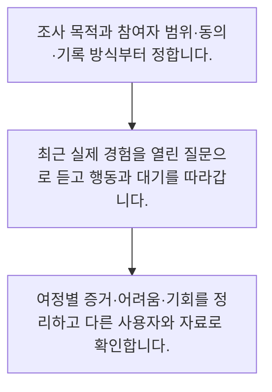

<!-- level:1 -->
# 사용자 인터뷰·여정 지도·업무 관찰

> **한 문장으로:** 사용자 조사는 원하는 답을 묻는 설문이 아니라, 실제 경험과 행동의 흐름에서 문제를 찾는 활동입니다.

## 왜 필요한가요?

AI가 도와주면 편하겠죠 같은 질문은 동의를 유도하기 쉽습니다. 과거 행동을 묻는 열린 질문과 실제 자료 관찰이 더 구체적인 근거를 줍니다. 소수 인터뷰의 빈도를 전체 고객 비율처럼 보고하지 않습니다.

## 일상에서 떠올려 보기

길을 잃은 사람에게 지도가 예쁘면 좋겠죠라고 묻기보다 방금 어디서 헤맸는지 함께 걸어 봅니다. 업무 조사도 마지막으로 겪은 일을 따라가며 행동·대기·실패를 확인하면 추상적인 칭찬보다 구체적인 단서를 얻습니다.

## 순서대로 따라가기

1. 조사 목적과 참여자 범위·동의·기록 방식부터 정합니다.
2. 최근 실제 경험을 열린 질문으로 듣고 행동과 대기를 따라갑니다.
3. 여정별 증거·어려움·기회를 정리하고 다른 사용자와 자료로 확인합니다.



## 처음 만나는 용어

| 용어 | 쉬운 뜻 |
|---|---|
| 유도 질문 | 특정 답을 기대한다는 단서를 담은 질문 |
| 여정 지도 | 사용자가 목적을 달성하는 단계와 경험을 정리한 지도 |
| 표본 편향 | 참여자 구성이 전체 사용 상황과 다르게 치우친 상태 |

**비유의 한계:** 조사자는 사용자의 모든 상황을 재현할 수 없습니다. 동의와 개인정보 보호를 지키고 참여자의 배경·제외된 집단·관찰 환경의 한계를 함께 기록합니다.

## 스스로 확인

유도 질문을 피한 질문은 무엇인가요?

**답과 이유:** 마지막으로 그 일을 했던 과정을 설명해 주세요 — 과거 경험을 열린 질문으로 물으면 기대한 답보다 실제 맥락을 들을 수 있습니다.
<!-- level:2 -->
# 사용자 인터뷰·여정 지도·업무 관찰 — 실제 흐름 따라가기

## 읽기 전 길잡이

사용자 조사는 원하는 답을 묻는 설문이 아니라, 실제 경험과 행동의 흐름에서 문제를 찾는 활동입니다. 아래 예제는 외부 시스템에 연결하지 않는 작은 학습용 사례입니다. 입력, 처리 조건, 결과를 순서대로 살펴보세요.

1. 조사 목적과 참여자 범위·동의·기록 방식부터 정합니다.
2. 최근 실제 경험을 열린 질문으로 듣고 행동과 대기를 따라갑니다.
3. 여정별 증거·어려움·기회를 정리하고 다른 사용자와 자료로 확인합니다.

## 예제로 확인하기

```markdown
# 인터뷰 질문 예시
- 마지막으로 정책을 찾았던 일을 처음부터 설명해 주세요.
- 그때 어떤 자료를 먼저 열었나요?
- 막혔을 때 다음으로 무엇을 했나요?
- 결과를 믿을 수 있다고 판단한 근거는 무엇인가요?

# 여정 기록
1. 문의 접수: 정보 누락 여부 확인
2. 정책 탐색: 실제 행동과 대기 기록
3. 답변 결정: 근거·확신·도움 요청 경로
4. 종료: 재문의와 수정 여부
- 발언과 관찰을 구분하고 식별정보는 최소 수집
```

## 결과를 해석하기

AI가 도와주면 편하겠죠 같은 질문은 동의를 유도하기 쉽습니다. 과거 행동을 묻는 열린 질문과 실제 자료 관찰이 더 구체적인 근거를 줍니다. 소수 인터뷰의 빈도를 전체 고객 비율처럼 보고하지 않습니다.

## 실무에 옮기기 전

조사자는 사용자의 모든 상황을 재현할 수 없습니다. 동의와 개인정보 보호를 지키고 참여자의 배경·제외된 집단·관찰 환경의 한계를 함께 기록합니다. 실제 업무에서는 원인을 모를 때는 인터뷰와 관찰로 가설을 만들고 규모를 확인할 때는 적절한 로그·설문을 함께 사용합니다. 민감한 업무 화면을 무단 기록하지 말고 조사 동의·보관·삭제 조건을 먼저 정합니다.

## 확인 질문

여정 지도에서 함께 기록할 것은 무엇인가요?

**답과 이유:** 사용자의 목적과 실제 업무 흐름을 연결해야 개선할 지점을 찾을 수 있습니다.
<!-- level:3 -->
# 사용자 인터뷰·여정 지도·업무 관찰 — 가상 사례로 문제 해결하기

실제 고객의 장애 기록이 아닌 학습용 재현 시나리오입니다. 결과만 바꾸기 전에 관측한 증거와 원인 가설을 구분합니다.

## 1. 어떤 문제가 생겼나요?

인터뷰에서는 모두 좋다고 했지만 실제 사용률은 낮습니다.

## 2. 먼저 확인할 증거

질문 대부분이 기능을 설명한 뒤 동의를 구했고 숙련 사용자만 참여했습니다.

## 3. 원인 가설

유도 질문과 표본 편향이 실제 장벽을 가린 것이 원인 가설입니다.

## 4. 수정 방법

초보·숙련·접근성 요구가 다른 사용자를 포함하고 실제 업무를 수행하는 과정을 관찰합니다.

## 5. 재검증

발언과 행동이 다른 지점을 추가 조사하고 결과의 적용 범위와 남은 불확실성을 명시합니다.

## 놓치기 쉬운 조건

조사자는 사용자의 모든 상황을 재현할 수 없습니다. 동의와 개인정보 보호를 지키고 참여자의 배경·제외된 집단·관찰 환경의 한계를 함께 기록합니다.

## 확인 질문

칭찬과 사용률이 다르면 먼저 점검할 것은 무엇인가요?

**답과 이유:** 말과 행동이 다를 수 있으므로 조사 설계와 실제 사용 맥락을 확인해야 합니다.
<!-- level:4 -->
# 사용자 인터뷰·여정 지도·업무 관찰 — 업무와 아키텍처의 선택

## 읽기 전 길잡이

같은 개념도 업무의 규모, 오류 비용, 운영 역량에 따라 적용 방식이 달라집니다. 아래 비교는 특정 제품의 성능 순위가 아닌 선택 기준입니다.

| 선택 | 얻는 점 | 감수할 점 |
|---|---|---|
| 심층 인터뷰·관찰 | 맥락과 원인을 자세히 이해 | 시간이 들며 전체 비율 추정에는 한계 |
| 행동 로그·설문 | 넓은 사용 패턴과 분포 파악 | 이유를 직접 설명하지 못하고 계측 편향 가능 |

## 선택 기준

원인을 모를 때는 인터뷰와 관찰로 가설을 만들고 규모를 확인할 때는 적절한 로그·설문을 함께 사용합니다. 민감한 업무 화면을 무단 기록하지 말고 조사 동의·보관·삭제 조건을 먼저 정합니다.

## 도입과 운영에서 확인할 것

초보·숙련·접근성 요구가 다른 사용자를 포함하고 실제 업무를 수행하는 과정을 관찰합니다. 발언과 행동이 다른 지점을 추가 조사하고 결과의 적용 범위와 남은 불확실성을 명시합니다.

## 판단 연습

소수 인터뷰 결과를 어떻게 보고하나요?

**판단의 근거:** 질적 조사는 원인과 가설을 찾는 데 유용하지만 대표성이나 비율을 자동으로 보장하지 않습니다.

참고: [GOV.UK Service Manual](https://www.gov.uk/service-manual), [WCAG 2.2](https://www.w3.org/TR/WCAG22/).
<!-- quizzes -->
[{"level":1,"question":"유도 질문을 피한 질문은 무엇인가요?","choices":["다들 원하니 동의하시죠","마지막으로 그 일을 했던 과정을 설명해 주세요","AI가 도와주면 좋겠죠","이 화면 정말 편하죠"],"answer_index":1,"explanation":"과거 경험을 열린 질문으로 물으면 기대한 답보다 실제 맥락을 들을 수 있습니다."},{"level":2,"question":"여정 지도에서 함께 기록할 것은 무엇인가요?","choices":["개발 일정만","경쟁사 로고만","단계별 행동·대기·어려움과 증거","감정 아이콘만"],"answer_index":2,"explanation":"사용자의 목적과 실제 업무 흐름을 연결해야 개선할 지점을 찾을 수 있습니다."},{"level":3,"question":"칭찬과 사용률이 다르면 먼저 점검할 것은 무엇인가요?","choices":["칭찬을 매출로 간주","사용하지 않은 사람을 제외","불편 의견 삭제","질문 방식과 참여자 편향·실제 행동"],"answer_index":3,"explanation":"말과 행동이 다를 수 있으므로 조사 설계와 실제 사용 맥락을 확인해야 합니다."},{"level":4,"question":"소수 인터뷰 결과를 어떻게 보고하나요?","choices":["맥락과 한계를 명시하고 추가 증거로 확인한다","전체 고객의 정확한 비율로 발표한다","통계 검증이 끝났다고 한다","개인정보를 전부 공개한다"],"answer_index":0,"explanation":"질적 조사는 원인과 가설을 찾는 데 유용하지만 대표성이나 비율을 자동으로 보장하지 않습니다."}]
