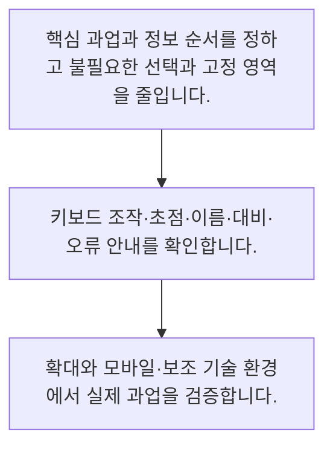

<!-- level:1 -->
# UX·접근성·인지 부담 줄이기

> **한 문장으로:** 좋은 UX는 화면을 예쁘게 만드는 데서 끝나지 않고, 다양한 사람이 적은 혼란으로 일을 끝내도록 돕습니다.

## 왜 필요한가요?

필요한 버튼을 못 찾거나 고정 영역이 본문을 가리면 좋은 내용도 쓰기 어렵습니다. 정보 순서와 다양한 조작·읽기 환경을 확인하면 더 많은 사람이 적은 혼란으로 일을 마칠 수 있습니다.

## 일상에서 떠올려 보기

역 안내판은 글자·화살표·위치가 함께 맞아야 길을 찾을 수 있습니다. 초록색 표시만으로 출구를 구분하면 색을 구분하기 어려운 사람은 놓칠 수 있습니다. 웹에서도 정보와 조작 방법을 여러 방식으로 전달해야 합니다.

## 순서대로 따라가기

1. 핵심 과업과 정보 순서를 정하고 불필요한 선택과 고정 영역을 줄입니다.
2. 키보드 조작·초점·이름·대비·오류 안내를 확인합니다.
3. 확대와 모바일·보조 기술 환경에서 실제 과업을 검증합니다.



## 처음 만나는 용어

| 용어 | 쉬운 뜻 |
|---|---|
| 인지 부담 | 화면을 이해하고 선택하는 데 필요한 정신적 노력 |
| 초점 | 키보드 조작의 현재 대상 위치 |
| 접근 가능한 이름 | 보조 기술이 조작 대상을 설명할 때 쓰는 이름 |

**비유의 한계:** 접근성은 한 번의 자동 검사로 보장되지 않습니다. 키보드·화면낭독기·확대·작은 화면·다양한 사용자 과업을 함께 점검하며 표준의 적용 수준과 범위를 명확히 해야 합니다.

## 스스로 확인

상태를 초록색만으로 표시할 때 보완할 것은 무엇인가요?

**답과 이유:** 완료 텍스트와 구분 가능한 아이콘 — 색만으로 전달하면 색 구분이나 시각 사용에 제약이 있는 사람이 정보를 놓칠 수 있습니다.
<!-- level:2 -->
# UX·접근성·인지 부담 줄이기 — 실제 흐름 따라가기

## 읽기 전 길잡이

좋은 UX는 화면을 예쁘게 만드는 데서 끝나지 않고, 다양한 사람이 적은 혼란으로 일을 끝내도록 돕습니다. 아래 예제는 외부 시스템에 연결하지 않는 작은 학습용 사례입니다. 입력, 처리 조건, 결과를 순서대로 살펴보세요.

1. 핵심 과업과 정보 순서를 정하고 불필요한 선택과 고정 영역을 줄입니다.
2. 키보드 조작·초점·이름·대비·오류 안내를 확인합니다.
3. 확대와 모바일·보조 기술 환경에서 실제 과업을 검증합니다.

## 예제로 확인하기

```markdown
# 학습 리더 점검 예시
- 본문을 읽을 수 있는 공간이 충분한가?
- 닫기·다음 단계 버튼을 키보드로 실행할 수 있는가?
- 모달을 열면 적절한 위치로 초점이 이동하고 닫으면 돌아오는가?
- 완료 상태를 색과 텍스트·아이콘으로 함께 전달하는가?
- 글자 확대 시 가로로 밀려 핵심 버튼이 사라지지 않는가?
- 코드 블록의 긴 줄이 전체 페이지 폭을 깨지 않는가?
- 오류 메시지는 원인과 다음 행동을 알려 주는가?
```

## 결과를 해석하기

버튼에 아이콘만 있으면 접근 가능한 이름을 제공해야 합니다. 자동 검사와 코드 리뷰로 구조적 문제를 찾고 실제 키보드·보조 기술 사용으로 작업 흐름을 확인합니다. WCAG 2.2는 여러 검증 가능한 기준을 제공하지만 이 예제 목록만으로 적합성을 선언할 수는 없습니다.

## 실무에 옮기기 전

접근성은 한 번의 자동 검사로 보장되지 않습니다. 키보드·화면낭독기·확대·작은 화면·다양한 사용자 과업을 함께 점검하며 표준의 적용 수준과 범위를 명확히 해야 합니다. 실제 업무에서는 핵심 사용자 과업을 먼저 배치하고 사용 빈도·화면 크기에 따라 도구의 노출을 조절합니다. 시각적 미니멀리즘을 위해 필요한 라벨·오류 설명·초점 표시까지 없애지 말고 접근성 요구를 설계와 검수에 포함합니다.

## 확인 질문

아이콘 전용 버튼에 필요한 것은 무엇인가요?

**답과 이유:** 보조 기술을 사용하는 사람도 조작 대상을 이해할 수 있도록 의미 있는 이름이 필요합니다.
<!-- level:3 -->
# UX·접근성·인지 부담 줄이기 — 가상 사례로 문제 해결하기

실제 고객의 장애 기록이 아닌 학습용 재현 시나리오입니다. 결과만 바꾸기 전에 관측한 증거와 원인 가설을 구분합니다.

## 1. 어떤 문제가 생겼나요?

모바일 학습 화면에서 위아래 고정 도구가 본문 대부분을 가립니다.

## 2. 먼저 확인할 증거

작은 화면에서 본문 높이가 줄고 확대 시 버튼과 탭이 겹칩니다.

## 3. 원인 가설

데스크톱 배치를 그대로 줄이며 읽기 과업보다 도구를 우선한 것이 원인 가설입니다.

## 4. 수정 방법

고정 영역을 최소화하고 부가 설명을 본문 흐름으로 이동하며 조작 버튼의 이름과 초점을 점검합니다.

## 5. 재검증

작은 화면·확대·키보드·화면낭독기에서 열기·읽기·단계 전환·닫기 과업을 반복 확인합니다.

## 놓치기 쉬운 조건

접근성은 한 번의 자동 검사로 보장되지 않습니다. 키보드·화면낭독기·확대·작은 화면·다양한 사용자 과업을 함께 점검하며 표준의 적용 수준과 범위를 명확히 해야 합니다.

## 확인 질문

고정 영역이 본문을 가리면 어떻게 개선하나요?

**답과 이유:** 읽기 공간을 확보하면서도 필요한 조작과 접근성은 유지해야 합니다.
<!-- level:4 -->
# UX·접근성·인지 부담 줄이기 — 업무와 아키텍처의 선택

## 읽기 전 길잡이

같은 개념도 업무의 규모, 오류 비용, 운영 역량에 따라 적용 방식이 달라집니다. 아래 비교는 특정 제품의 성능 순위가 아닌 선택 기준입니다.

| 선택 | 얻는 점 | 감수할 점 |
|---|---|---|
| 항상 보이는 많은 도구 | 숙련자의 반복 조작이 빠를 수 있음 | 본문 공간과 주의력을 차지함 |
| 핵심 조작만 노출하고 부가 기능 접기 | 읽기와 작은 화면에 집중하기 쉬움 | 부가 기능의 발견성을 설계해야 함 |

## 선택 기준

핵심 사용자 과업을 먼저 배치하고 사용 빈도·화면 크기에 따라 도구의 노출을 조절합니다. 시각적 미니멀리즘을 위해 필요한 라벨·오류 설명·초점 표시까지 없애지 말고 접근성 요구를 설계와 검수에 포함합니다.

## 도입과 운영에서 확인할 것

고정 영역을 최소화하고 부가 설명을 본문 흐름으로 이동하며 조작 버튼의 이름과 초점을 점검합니다. 작은 화면·확대·키보드·화면낭독기에서 열기·읽기·단계 전환·닫기 과업을 반복 확인합니다.

## 판단 연습

자동 접근성 검사 통과 후에도 무엇을 해야 하나요?

**판단의 근거:** 자동 검사가 모든 사용성·접근성 문제를 찾는 것은 아니므로 실제 흐름의 확인이 필요합니다.

참고: [GOV.UK Service Manual](https://www.gov.uk/service-manual), [WCAG 2.2](https://www.w3.org/TR/WCAG22/).
<!-- quizzes -->
[{"level":1,"question":"상태를 초록색만으로 표시할 때 보완할 것은 무엇인가요?","choices":["모든 설명 삭제","완료 텍스트와 구분 가능한 아이콘","더 작은 글자","색을 더 흐리게"],"answer_index":1,"explanation":"색만으로 전달하면 색 구분이나 시각 사용에 제약이 있는 사람이 정보를 놓칠 수 있습니다."},{"level":2,"question":"아이콘 전용 버튼에 필요한 것은 무엇인가요?","choices":["툴팁 없는 빈 영역","클릭할 수 없는 장식","기능을 설명하는 접근 가능한 이름","파일 이름만"],"answer_index":2,"explanation":"보조 기술을 사용하는 사람도 조작 대상을 이해할 수 있도록 의미 있는 이름이 필요합니다."},{"level":3,"question":"고정 영역이 본문을 가리면 어떻게 개선하나요?","choices":["본문 글자를 계속 줄인다","확대를 막는다","닫기 버튼을 없앤다","핵심 도구를 압축하고 부가 정보를 스크롤 흐름으로 옮긴다"],"answer_index":3,"explanation":"읽기 공간을 확보하면서도 필요한 조작과 접근성은 유지해야 합니다."},{"level":4,"question":"자동 접근성 검사 통과 후에도 무엇을 해야 하나요?","choices":["키보드·보조 기술·확대 환경에서 실제 과업 검증","즉시 완벽한 적합성 선언","사용자 테스트 중단","초점 표시 삭제"],"answer_index":0,"explanation":"자동 검사가 모든 사용성·접근성 문제를 찾는 것은 아니므로 실제 흐름의 확인이 필요합니다."}]
