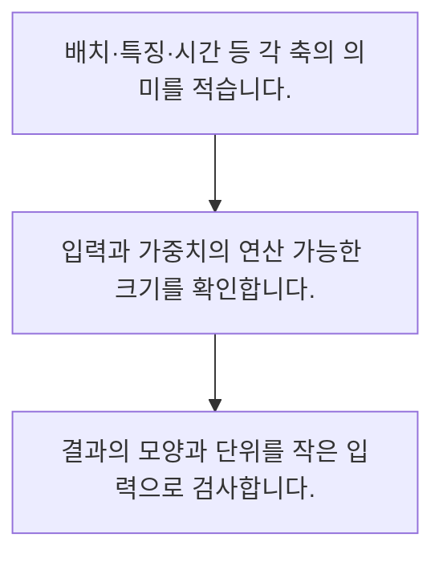

<!-- level:1 -->
# 벡터·행렬·텐서와 차원

> **한 문장으로:** 모델의 자료와 연산은 여러 축을 가진 숫자 배열로 표현하며 각 축의 의미와 크기를 맞춰야 합니다.

## 왜 필요한가요?

두 행을 각각 한 예제로 보고 길이 2 가중치와 내적하면 예제당 숫자 하나가 나옵니다. 배치 크기 2와 피처 수 2가 우연히 같아도 서로 다른 축입니다.

## 일상에서 떠올려 보기

성적표에서 행은 학생, 열은 과목입니다. 같은 숫자 표라도 행과 열을 바꾸면 누구의 무엇을 계산하는지가 달라집니다.

## 순서대로 따라가기

1. 배치·특징·시간 등 각 축의 의미를 적습니다.
2. 입력과 가중치의 연산 가능한 크기를 확인합니다.
3. 결과의 모양과 단위를 작은 입력으로 검사합니다.



## 처음 만나는 용어

| 용어 | 쉬운 뜻 |
|---|---|
| 벡터 | 한 축을 가진 숫자 배열 |
| 행렬 | 행과 열의 두 축을 가진 숫자 배열 |
| 텐서 | 여러 축의 숫자 배열을 일반화한 표현 |

**비유의 한계:** 파이썬 리스트 예제는 배열의 모양을 설명합니다. 실제 텐서는 자료형·메모리 배치·연산 장치·자동 미분 속성도 갖습니다.

## 스스로 확인

텐서 축에서 먼저 정의할 것은?

**답과 이유:** 각 축의 의미 — 같은 크기라도 배치·피처·시간은 다른 의미이므로 구별해야 합니다.
<!-- level:2 -->
# 벡터·행렬·텐서와 차원 — 실제 흐름 따라가기

## 읽기 전 길잡이

모델의 자료와 연산은 여러 축을 가진 숫자 배열로 표현하며 각 축의 의미와 크기를 맞춰야 합니다. 아래 예제는 외부 시스템에 연결하지 않는 작은 학습용 사례입니다. 입력, 처리 조건, 결과를 순서대로 살펴보세요.

1. 배치·특징·시간 등 각 축의 의미를 적습니다.
2. 입력과 가중치의 연산 가능한 크기를 확인합니다.
3. 결과의 모양과 단위를 작은 입력으로 검사합니다.

## 예제로 확인하기

```python
x=[[1,2],[3,4]]; w=[2,1]
y=[sum(a*b for a,b in zip(row,w)) for row in x]
assert y==[4,10]
print(y)
```

## 결과를 해석하기

두 행을 각각 한 예제로 보고 길이 2 가중치와 내적하면 예제당 숫자 하나가 나옵니다. 배치 크기 2와 피처 수 2가 우연히 같아도 서로 다른 축입니다.

## 실무에 옮기기 전

파이썬 리스트 예제는 배열의 모양을 설명합니다. 실제 텐서는 자료형·메모리 배치·연산 장치·자동 미분 속성도 갖습니다. 실제 업무에서는 배열의 원소 개수만 맞추지 말고 축의 업무 의미를 유지합니다. 큰 텐서는 자료형과 복사·장치 이동에 따른 메모리 비용도 측정합니다.

## 확인 질문

예제 출력은 무엇인가요?

**답과 이유:** 각 행과 가중치 2·1을 내적한 결과입니다.
<!-- level:3 -->
# 벡터·행렬·텐서와 차원 — 가상 사례로 문제 해결하기

실제 고객의 장애 기록이 아닌 학습용 재현 시나리오입니다. 결과만 바꾸기 전에 관측한 증거와 원인 가설을 구분합니다.

## 1. 어떤 문제가 생겼나요?

가상 모델이 배치 크기를 바꾸자 출력 모양 오류가 납니다.

## 2. 먼저 확인할 증거

각 연산 전후 shape와 축 이름을 기록합니다.

## 3. 원인 가설

배치 축을 피처 축으로 착각해 고정 크기로 펼쳤습니다.

## 4. 수정 방법

축 의미에 맞춰 reshape와 행렬 곱을 수정합니다.

## 5. 재검증

배치 1·여러 개와 서로 다른 입력 길이를 시험합니다.

## 놓치기 쉬운 조건

파이썬 리스트 예제는 배열의 모양을 설명합니다. 실제 텐서는 자료형·메모리 배치·연산 장치·자동 미분 속성도 갖습니다.

## 확인 질문

배치 크기 변경으로 오류가 나면?

**답과 이유:** 배치 축을 피처로 착각한 고정 reshape를 확인해야 합니다.
<!-- level:4 -->
# 벡터·행렬·텐서와 차원 — 업무와 아키텍처의 선택

## 읽기 전 길잡이

같은 개념도 업무의 규모, 오류 비용, 운영 역량에 따라 적용 방식이 달라집니다. 아래 비교는 특정 제품의 성능 순위가 아닌 선택 기준입니다.

| 선택 | 얻는 점 | 감수할 점 |
|---|---|---|
| 고정 크기 입력 | 연산 최적화가 쉬움 | 다양한 길이 처리 제한 |
| 가변 크기 입력 | 실제 자료에 유연 | 패딩·마스킹·컴파일 관리 |

## 선택 기준

배열의 원소 개수만 맞추지 말고 축의 업무 의미를 유지합니다. 큰 텐서는 자료형과 복사·장치 이동에 따른 메모리 비용도 측정합니다.

## 도입과 운영에서 확인할 것

축 의미에 맞춰 reshape와 행렬 곱을 수정합니다. 배치 1·여러 개와 서로 다른 입력 길이를 시험합니다.

## 판단 연습

가변 길이 입력의 추가 비용은?

**판단의 근거:** 유연성에는 길이 정렬과 마스킹 등 구현·운영 부담이 따릅니다.

참고: [PyTorch 기초](https://docs.pytorch.org/tutorials/beginner/basics/intro.html), [Attention Is All You Need](https://arxiv.org/abs/1706.03762), [DDPM 논문](https://arxiv.org/abs/2006.11239).
<!-- quizzes -->
[{"level":1,"question":"텐서 축에서 먼저 정의할 것은?","choices":["각 축의 의미","파일 이름","원소 합계만","서버 위치"],"answer_index":0,"explanation":"같은 크기라도 배치·피처·시간은 다른 의미이므로 구별해야 합니다."},{"level":2,"question":"예제 출력은 무엇인가요?","choices":["1과 2","4와 10","2와 4","3과 7"],"answer_index":1,"explanation":"각 행과 가중치 2·1을 내적한 결과입니다."},{"level":3,"question":"배치 크기 변경으로 오류가 나면?","choices":["값만 정렬","오류 무시","축과 reshape 점검","항상 배치 고정"],"answer_index":2,"explanation":"배치 축을 피처로 착각한 고정 reshape를 확인해야 합니다."},{"level":4,"question":"가변 길이 입력의 추가 비용은?","choices":["항상 계산량 감소","메모리 이동 제거","차원 검사 불필요","패딩과 마스크 관리"],"answer_index":3,"explanation":"유연성에는 길이 정렬과 마스킹 등 구현·운영 부담이 따릅니다."}]
