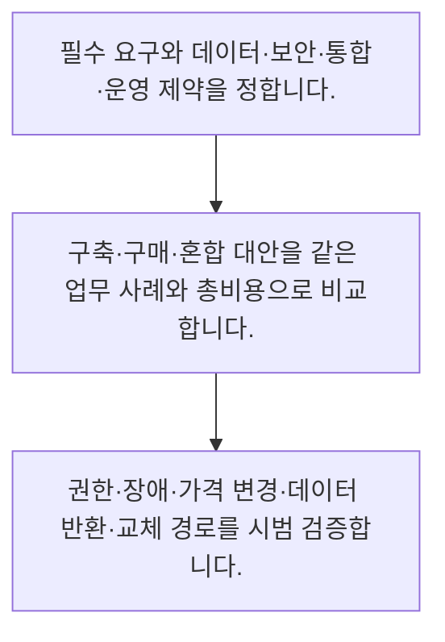

<!-- level:1 -->
# 직접 구축·구매·외부 서비스 평가

> **한 문장으로:** 구축과 구매의 선택은 기능 비교를 넘어 데이터 통제·운영 역량·통합·계약·이탈 비용을 함께 따지는 결정입니다.

## 왜 필요한가요?

빠르게 구매할지 직접 만들지에는 하나의 정답이 없습니다. 데이터·운영 역량·전체 비용·교체 가능성을 비교하면 도입 이후까지 감당할 수 있는 선택을 할 수 있습니다.

## 일상에서 떠올려 보기

직접 요리하면 재료와 과정을 통제하지만 장보기와 설거지가 필요합니다. 배달은 빠르지만 제공 메뉴와 시간에 의존합니다. 서비스도 외부 도구를 쓰면 초기 속도를 얻고 직접 구축하면 통제와 유지 책임을 함께 갖습니다.

## 순서대로 따라가기

1. 필수 요구와 데이터·보안·통합·운영 제약을 정합니다.
2. 구축·구매·혼합 대안을 같은 업무 사례와 총비용으로 비교합니다.
3. 권한·장애·가격 변경·데이터 반환·교체 경로를 시범 검증합니다.



## 처음 만나는 용어

| 용어 | 쉬운 뜻 |
|---|---|
| 벤더 종속 | 공급자 변경 때 데이터·API·운영 방식 때문에 큰 비용이 생기는 상태 |
| SLA | 서비스 수준과 책임·측정 조건을 정한 약정 |
| 출구 전략 | 계약 종료나 교체 때 데이터와 업무를 이전하는 계획 |

**비유의 한계:** 서비스 공급자는 음식점보다 복잡한 데이터 처리·권한·가용성 조건을 가집니다. 구매했다고 책임이 사라지지 않고 오픈소스를 쓴다고 운영과 보안이 무료가 되지 않습니다.

## 스스로 확인

외부 서비스를 구매하면 어떤 책임이 남나요?

**답과 이유:** 자신의 데이터·통합·업무 운영과 위험 관리 — 외부 공급자를 써도 서비스 이용 조직의 업무와 데이터 책임은 남습니다.
<!-- level:2 -->
# 직접 구축·구매·외부 서비스 평가 — 실제 흐름 따라가기

## 읽기 전 길잡이

구축과 구매의 선택은 기능 비교를 넘어 데이터 통제·운영 역량·통합·계약·이탈 비용을 함께 따지는 결정입니다. 아래 예제는 외부 시스템에 연결하지 않는 작은 학습용 사례입니다. 입력, 처리 조건, 결과를 순서대로 살펴보세요.

1. 필수 요구와 데이터·보안·통합·운영 제약을 정합니다.
2. 구축·구매·혼합 대안을 같은 업무 사례와 총비용으로 비교합니다.
3. 권한·장애·가격 변경·데이터 반환·교체 경로를 시범 검증합니다.

## 예제로 확인하기

```markdown
# 공급자 평가 카드
- 필수 업무 사례: 권한 있는 정책 문서 검색
- 데이터: 저장 위치·보존·삭제·학습 사용 조건 확인
- 통합: 인증·로그·내보내기 형식·한도
- 운영: 장애 연락·복구 조건·지원 범위
- 비용: 기본료·사용량·평가·검토·이전
- 대안: 직접 구축 / 외부 구매 / 검색만 외부 사용
- 출구 검증: 표본 데이터 내보내기 후 대체 환경에서 복원
- 결정: 조건·예외·승인자·재검토 시점 기록
```

## 결과를 해석하기

기능이 같아 보여도 데이터 삭제 범위, 로그의 개인정보, 사용량 한도, 장애 대응은 다를 수 있습니다. 실제 계약과 제품 문서를 확인해야 하며 SLA 문구만으로 자신의 업무 복구가 보장되지는 않습니다. 내보내기 기능은 실제 재사용 가능한 형태인지 시험합니다.

## 실무에 옮기기 전

서비스 공급자는 음식점보다 복잡한 데이터 처리·권한·가용성 조건을 가집니다. 구매했다고 책임이 사라지지 않고 오픈소스를 쓴다고 운영과 보안이 무료가 되지 않습니다. 실제 업무에서는 차별화 가치·데이터 제약·보유 역량·변경 속도를 기준으로 선택합니다. 공급자 평가에는 장애와 종료 시나리오를 포함하고 특정 모델이나 API의 교체가 필요한 경계를 설계하되 추상화 비용도 함께 고려합니다.

## 확인 질문

출구 전략의 실제 검증은 무엇인가요?

**답과 이유:** 버튼이 있어도 권한과 버전이 빠지면 업무를 복구하지 못하므로 복원까지 확인해야 합니다.
<!-- level:3 -->
# 직접 구축·구매·외부 서비스 평가 — 가상 사례로 문제 해결하기

실제 고객의 장애 기록이 아닌 학습용 재현 시나리오입니다. 결과만 바꾸기 전에 관측한 증거와 원인 가설을 구분합니다.

## 1. 어떤 문제가 생겼나요?

시범 도구의 성능은 좋지만 계약 종료 시 문서와 평가 기록을 이전할 수 없습니다.

## 2. 먼저 확인할 증거

내보내기는 요약 CSV만 제공하고 권한·버전·원문 연결은 없습니다.

## 3. 원인 가설

기능 시연에 집중해 데이터 이동성과 종료 조건을 확인하지 않은 것이 원인 가설입니다.

## 4. 수정 방법

필요 데이터와 메타데이터를 정의하고 내보내기·복원 가능성을 검증한 뒤 대안을 비교합니다.

## 5. 재검증

교체 시나리오에서 권한·버전·평가 기록이 유지되는지 확인하고 잔존 데이터 삭제 조건도 점검합니다.

## 놓치기 쉬운 조건

서비스 공급자는 음식점보다 복잡한 데이터 처리·권한·가용성 조건을 가집니다. 구매했다고 책임이 사라지지 않고 오픈소스를 쓴다고 운영과 보안이 무료가 되지 않습니다.

## 확인 질문

시범 성능은 좋지만 교체가 어렵다면 무엇을 점검하나요?

**답과 이유:** 도입 품질과 종료 가능성은 별도 조건이며 전체 수명주기 비용에 영향을 줍니다.
<!-- level:4 -->
# 직접 구축·구매·외부 서비스 평가 — 업무와 아키텍처의 선택

## 읽기 전 길잡이

같은 개념도 업무의 규모, 오류 비용, 운영 역량에 따라 적용 방식이 달라집니다. 아래 비교는 특정 제품의 성능 순위가 아닌 선택 기준입니다.

| 선택 | 얻는 점 | 감수할 점 |
|---|---|---|
| 외부 서비스 구매 | 초기 도입과 일부 운영을 빠르게 시작 | 한도·정책·가격·공급자에 의존 |
| 직접 구축 | 특수 요구와 데이터 흐름을 세밀하게 통제 | 개발·보안·장애·업데이트 책임 증가 |
| 혼합 구성 | 공통 기능은 구매하고 차별 영역에 집중 | 경계 통합과 책임 분담이 복잡해짐 |

## 선택 기준

차별화 가치·데이터 제약·보유 역량·변경 속도를 기준으로 선택합니다. 공급자 평가에는 장애와 종료 시나리오를 포함하고 특정 모델이나 API의 교체가 필요한 경계를 설계하되 추상화 비용도 함께 고려합니다.

## 도입과 운영에서 확인할 것

필요 데이터와 메타데이터를 정의하고 내보내기·복원 가능성을 검증한 뒤 대안을 비교합니다. 교체 시나리오에서 권한·버전·평가 기록이 유지되는지 확인하고 잔존 데이터 삭제 조건도 점검합니다.

## 판단 연습

직접 구축과 구매 선택의 적절한 기준은 무엇인가요?

**판단의 근거:** 어떤 방식도 모든 조건에서 우월하지 않으므로 업무 제약과 운영 책임을 함께 비교해야 합니다.

참고: [GOV.UK Service Manual](https://www.gov.uk/service-manual), [WCAG 2.2](https://www.w3.org/TR/WCAG22/).
<!-- quizzes -->
[{"level":1,"question":"외부 서비스를 구매하면 어떤 책임이 남나요?","choices":["자신의 데이터·통합·업무 운영과 위험 관리","모든 책임이 공급자로 사라진다","사용자 권한은 필요 없다","비용 측정은 불가능하다"],"answer_index":0,"explanation":"외부 공급자를 써도 서비스 이용 조직의 업무와 데이터 책임은 남습니다."},{"level":2,"question":"출구 전략의 실제 검증은 무엇인가요?","choices":["스크린샷만 저장한다","내보낸 데이터와 메타데이터를 대체 환경에서 복원한다","내보내기 버튼 존재만 본다","계약 제목만 읽는다"],"answer_index":1,"explanation":"버튼이 있어도 권한과 버전이 빠지면 업무를 복구하지 못하므로 복원까지 확인해야 합니다."},{"level":3,"question":"시범 성능은 좋지만 교체가 어렵다면 무엇을 점검하나요?","choices":["시연 동영상 길이","회사 로고","데이터 이동성·종료 조건·종속 비용","답변 말투만"],"answer_index":2,"explanation":"도입 품질과 종료 가능성은 별도 조건이며 전체 수명주기 비용에 영향을 줍니다."},{"level":4,"question":"직접 구축과 구매 선택의 적절한 기준은 무엇인가요?","choices":["항상 자체 구축","항상 가장 싼 월 요금","유명 공급자면 검토 생략","차별 가치·데이터 제약·운영 역량·총비용"],"answer_index":3,"explanation":"어떤 방식도 모든 조건에서 우월하지 않으므로 업무 제약과 운영 책임을 함께 비교해야 합니다."}]
