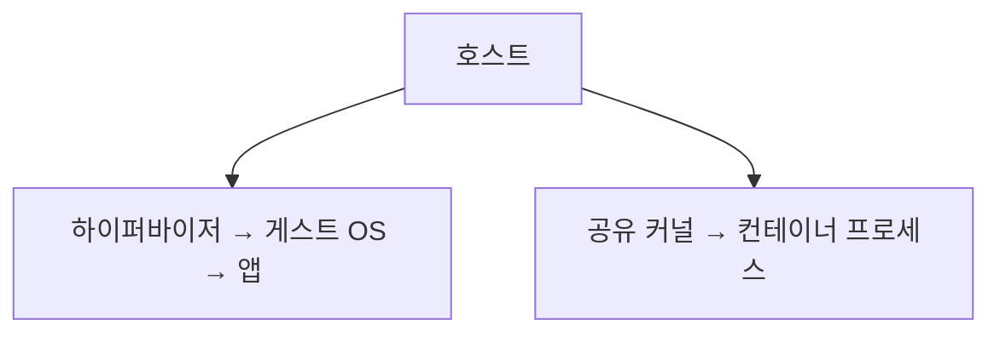

<!-- level:1 -->
# VM과 컨테이너 — 가상 컴퓨터와 격리된 프로세스

VM은 하이퍼바이저 위에 별도 게스트 운영체제를 실행하는 환경이다. 컨테이너는 호스트 커널을 공유하면서 프로세스의 자원·이름 공간과 파일 시스템 등을 격리한다. 컨테이너 이미지에는 앱과 의존성이 있지만 일반적인 VM처럼 독립 커널이 들어 있는 것은 아니다.



가방에 앱 실행에 필요한 물건을 담는 것이 이미지 비유이고, 그 가방으로 실제 여행을 하는 것이 컨테이너 실행 비유다. 같은 이미지로 여러 실행 인스턴스를 만들 수 있다. 이미지와 실행 중인 상태·데이터는 구분한다.

**비유의 한계:** 컨테이너는 완벽한 보안 경계가 아니며 privileged·호스트 mount·커널 취약점이 격리를 약화시킬 수 있다. macOS의 Linux 컨테이너 실행에는 일반적으로 Linux VM 계층이 필요하다.
<!-- level:2 -->
# namespace, cgroup, 이미지 계층

namespace는 프로세스가 보는 PID·네트워크·mount 같은 범위를 구분하고 cgroup은 자원 회계·제한을 제공한다. 이미지 레이어는 파일 시스템 변경을 쌓고 실행 컨테이너에는 쓰기 계층이 추가된다. 상태를 영속화하려면 volume 등 수명 경계를 명시한다.

로컬 Docker 학습 환경용 예제다. 포트는 loopback에만 공개한다.

```bash
docker run --rm --name web-lab \
  --memory=128m --cpus=1 \
  -p 127.0.0.1:8080:80 nginx:alpine
# 다른 터미널
curl http://127.0.0.1:8080
docker stats --no-stream web-lab
```

태그는 바뀔 수 있으므로 운영 배포에서는 검증된 digest와 업데이트 정책을 사용한다. 이 최소 예제는 운영 보안 설정 전체가 아니다. CPU 제한은 코어 전용 예약과 동일하지 않으며 메모리 제한은 OOM을 유발할 수 있다. 컨테이너 내부 root와 호스트 권한의 관계도 설정에 따라 검토한다.
<!-- level:3 -->
# 가상 장애 — 호스트 메모리는 남았는데 컨테이너가 종료된다

가상 서비스가 cgroup 한도를 넘어서 종료된다. 호스트 여유 메모리만 보고 원인을 배제하면 안 된다. 종료 상태·OOMKilled·컨테이너 사용량·limit·애플리케이션 힙과 외부 메모리를 확인한다.

**수정:** 워킹셋·동시 요청·버퍼 상한을 조정하고 런타임 메모리 한도를 컨테이너 예산과 맞춘다. limit만 늘리기 전에 누수와 부하 폭주를 구분한다. 파일이 실행 계층에만 저장되어 재시작 때 사라지는 문제는 volume 수명과 별도로 처리한다.

**재검증:** 최대 부하·재시작·이미지 교체에서 메모리·데이터·종료 신호를 확인한다. SIGTERM 처리와 graceful shutdown이 종료 기한 안에 끝나는지 검사한다.
<!-- level:4 -->
# 배포 단위와 격리 수준

| 선택 | 장점 | 비용 |
|---|---|---|
| VM | 독립 OS와 강한 경계 옵션 | 시작·메모리·패치 운영 |
| 컨테이너 | 일관된 패키징·밀도 | 공유 커널·자원·이미지 관리 |
| VM 안 컨테이너 | 두 운영 모델 결합 | 여러 계층의 관측·비용 |

신뢰하지 않는 코드를 실행할 때 일반 컨테이너만으로 충분하다고 가정하지 않는다. rootless·capability 축소·read-only 파일 시스템·seccomp·VM 샌드박스 등 위협에 맞는 경계를 검토한다. 공급망에는 이미지 출처·digest·스캔·보안 업데이트가 필요하다.

**판단 연습:** 사내 API와 사용자가 업로드한 코드를 실행하는 서비스는 같은 격리 요구를 가질까? 신뢰 경계·시작 지연·운영 비용을 비교하자.

참고: [Docker Overview](https://docs.docker.com/get-started/docker-overview/), [Docker Resource Constraints](https://docs.docker.com/engine/containers/resource_constraints/).
<!-- quizzes -->
[{"level":1,"question":"일반적인 컨테이너와 VM의 핵심 차이는?","choices":["컨테이너는 호스트 커널을 공유하는 격리 프로세스","컨테이너는 항상 독립 커널","VM은 프로세스가 없음","이미지와 실행은 완전히 동일"],"answer_index":0,"explanation":"VM은 게스트 OS 경계를, 일반 컨테이너는 공유 커널 위의 프로세스 격리를 사용합니다. 패키징과 보안 보장을 구분합니다."},{"level":2,"question":"cgroup이 제공하는 역할은?","choices":["HTTP 파싱","자원 회계와 제한","코드 자동 정규화","모든 보안 취약점 제거"],"answer_index":1,"explanation":"CPU·메모리 등 자원 사용을 관리합니다. namespace의 보이는 범위 격리나 앱 보안 계약과는 다른 역할입니다."},{"level":3,"question":"호스트 여유 RAM이 있는데 컨테이너 OOM이 나면 확인할 것은?","choices":["이미지 이름만","키보드 설정","cgroup limit과 프로세스 전체 메모리 사용","DNS TTL"],"answer_index":2,"explanation":"컨테이너 한도는 호스트 여유량과 다를 수 있습니다. 힙·버퍼·외부 메모리·동시 부하를 함께 조사합니다."},{"level":4,"question":"신뢰하지 않는 코드 실행의 격리 판단은?","choices":["모든 컨테이너가 완벽히 안전","privileged를 항상 켬","호스트 전체 mount","위협에 맞는 권한 축소와 VM·샌드박스 경계 검토"],"answer_index":3,"explanation":"공유 커널과 높은 권한은 위험을 만들 수 있습니다. 신뢰 경계에 맞춰 격리·자원·공급망 정책을 설계해야 합니다."}]
