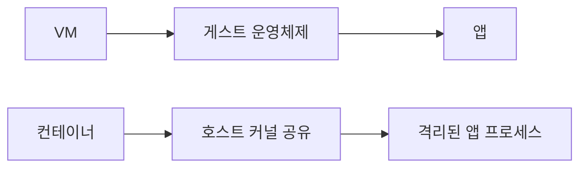

<!-- level:1 -->
# 가상 머신과 컨테이너 — 실행 환경을 나누는 두 방법

> **한 문장으로:** VM은 별도 운영체제를 포함한 환경을 만들고, 일반적인 컨테이너는 같은 커널을 공유하면서 프로그램을 격리합니다.

## 왜 필요한가요?

앱마다 필요한 도구와 설정이 다르고 서로 영향을 주지 않아야 합니다. 같은 서버에서 환경을 나누면서 배포를 반복할 방법이 필요합니다.

## 일상에서 떠올려 보기

VM은 각자 관리 설비를 갖춘 별도 집에, 컨테이너는 공용 설비를 함께 쓰면서 공간을 나눈 건물의 방에 비유할 수 있습니다. 공유하는 기반이 다르므로 비용과 격리 경계도 다릅니다.

## 순서대로 따라가기

1. VM은 가상 하드웨어 위에 게스트 운영체제를 실행합니다.
2. 컨테이너는 앱과 필요한 파일을 묶고 프로세스가 보는 자원 범위 등을 나눕니다.
3. 실행 환경을 여러 개 만들 때 자원 한도, 저장 데이터, 통신과 권한을 함께 정합니다.



## 작은 예로 확인하기

컨테이너 두 개가 서로 다른 파일 목록과 네트워크 공간을 보더라도 일반적으로 같은 호스트 커널을 사용합니다. 컨테이너를 작은 VM이라고 생각하면 공유 기반과 보안 경계를 잘못 이해할 수 있습니다.

## 처음 만나는 용어

| 용어 | 쉬운 뜻 |
|---|---|
| 가상 머신(VM) | 가상 하드웨어에서 별도 운영체제를 실행하는 환경입니다. |
| 컨테이너 | 공유 커널 위에서 자원 범위를 나누어 실행하는 프로그램 환경입니다. |
| 커널 | 운영체제의 핵심 자원 관리 부분입니다. |
| Docker 이미지 | 앱 실행에 필요한 파일과 실행 설정을 담은 배포 단위입니다. |

**비유의 한계:** 방을 나눴다는 비유가 완전한 보안 격리를 뜻하지 않습니다. 컨테이너의 권한과 공유 커널을 고려해야 하며, 사용하는 플랫폼이 내부에서 VM을 함께 쓸 수도 있습니다.

## 스스로 확인

일반적인 컨테이너마다 운영체제 커널이 따로 들어 있을까요?

**답과 이유:** 보통 호스트 커널을 공유합니다. VM은 게스트 운영체제를 실행하는 구조라는 점에서 기본 경계가 다릅니다.
<!-- level:2 -->
# namespace, cgroup, 이미지 계층

<!-- beginner-guide:start -->
## 읽기 전 길잡이

Docker 명령에서는 이미지, 실행 컨테이너, 밖으로 연 포트, 저장 공간을 구분하세요. 학습 예제는 현재 컴퓨터의 loopback에만 포트를 연결합니다.

## 이 단계에서 만날 말

| 용어 | 쉬운 뜻 |
|---|---|
| namespace | 프로세스가 보는 이름과 자원 범위를 구분하는 기능입니다. |
| cgroup | 프로세스 묶음의 자원 사용량을 관리·제한하는 기능입니다. |
| 이미지 레이어 | 파일 변경을 겹쳐 이미지 내용을 구성한 층입니다. |
| volume | 컨테이너 교체와 구분해 데이터를 보관하는 저장 연결입니다. |
| loopback | 현재 컴퓨터 안에서만 접근하는 네트워크 주소 범위입니다. |
| digest | 이미지 등 콘텐츠의 정확한 버전을 구별하는 해시 기반 식별자입니다. |

<!-- beginner-guide:end -->

namespace는 프로세스가 보는 PID·네트워크·mount 같은 범위를 구분하고 cgroup은 자원 회계·제한을 제공한다. 이미지 레이어는 파일 시스템 변경을 쌓고 실행 컨테이너에는 쓰기 계층이 추가된다. 상태를 영속화하려면 volume 등 수명 경계를 명시한다.

로컬 Docker 학습 환경용 예제다. 포트는 loopback에만 공개한다.

```bash
docker run --rm --name web-lab \
  --memory=128m --cpus=1 \
  -p 127.0.0.1:8080:80 nginx:alpine
# 다른 터미널
curl http://127.0.0.1:8080
docker stats --no-stream web-lab
```

태그는 바뀔 수 있으므로 운영 배포에서는 검증된 digest와 업데이트 정책을 사용한다. 이 최소 예제는 운영 보안 설정 전체가 아니다. CPU 제한은 코어 전용 예약과 동일하지 않으며 메모리 제한은 OOM을 유발할 수 있다. 컨테이너 내부 root와 호스트 권한의 관계도 설정에 따라 검토한다.
<!-- level:3 -->
# 가상 장애 — 호스트 메모리는 남았는데 컨테이너가 종료된다

<!-- beginner-guide:start -->
## 읽기 전 길잡이

실행 환경을 교체했더니 자료가 사라지는 사례를 봅니다. 앱 파일, 쓰기 계층, 별도로 유지하는 데이터의 수명을 구분해 저장 경계를 조사하세요.

<!-- beginner-guide:end -->

가상 서비스가 cgroup 한도를 넘어서 종료된다. 호스트 여유 메모리만 보고 원인을 배제하면 안 된다. 종료 상태·OOMKilled·컨테이너 사용량·limit·애플리케이션 힙과 외부 메모리를 확인한다.

**수정:** 워킹셋·동시 요청·버퍼 상한을 조정하고 런타임 메모리 한도를 컨테이너 예산과 맞춘다. limit만 늘리기 전에 누수와 부하 폭주를 구분한다. 파일이 실행 계층에만 저장되어 재시작 때 사라지는 문제는 volume 수명과 별도로 처리한다.

**재검증:** 최대 부하·재시작·이미지 교체에서 메모리·데이터·종료 신호를 확인한다. SIGTERM 처리와 graceful shutdown이 종료 기한 안에 끝나는지 검사한다.
<!-- level:4 -->
# 배포 단위와 격리 수준

<!-- beginner-guide:start -->
## 읽기 전 길잡이

배포 속도와 자원 효율, 보안 격리, 운영체제 요구를 함께 비교합니다. 어떤 기반을 공유하는지 먼저 그려 보면 VM과 컨테이너의 선택이 명확해집니다.

<!-- beginner-guide:end -->

| 선택 | 장점 | 비용 |
|---|---|---|
| VM | 독립 OS와 강한 경계 옵션 | 시작·메모리·패치 운영 |
| 컨테이너 | 일관된 패키징·밀도 | 공유 커널·자원·이미지 관리 |
| VM 안 컨테이너 | 두 운영 모델 결합 | 여러 계층의 관측·비용 |

신뢰하지 않는 코드를 실행할 때 일반 컨테이너만으로 충분하다고 가정하지 않는다. rootless·capability 축소·read-only 파일 시스템·seccomp·VM 샌드박스 등 위협에 맞는 경계를 검토한다. 공급망에는 이미지 출처·digest·스캔·보안 업데이트가 필요하다.

**판단 연습:** 사내 API와 사용자가 업로드한 코드를 실행하는 서비스는 같은 격리 요구를 가질까? 신뢰 경계·시작 지연·운영 비용을 비교하자.

참고: [Docker Overview](https://docs.docker.com/get-started/docker-overview/), [Docker Resource Constraints](https://docs.docker.com/engine/containers/resource_constraints/).
<!-- quizzes -->
[{"level":1,"question":"일반적인 컨테이너와 VM의 핵심 차이는?","choices":["컨테이너는 호스트 커널을 공유하는 격리 프로세스","컨테이너는 항상 독립 커널","VM은 프로세스가 없음","이미지와 실행은 완전히 동일"],"answer_index":0,"explanation":"VM은 게스트 OS 경계를, 일반 컨테이너는 공유 커널 위의 프로세스 격리를 사용합니다. 패키징과 보안 보장을 구분합니다."},{"level":2,"question":"cgroup이 제공하는 역할은?","choices":["HTTP 파싱","자원 회계와 제한","코드 자동 정규화","모든 보안 취약점 제거"],"answer_index":1,"explanation":"CPU·메모리 등 자원 사용을 관리합니다. namespace의 보이는 범위 격리나 앱 보안 계약과는 다른 역할입니다."},{"level":3,"question":"호스트 여유 RAM이 있는데 컨테이너 OOM이 나면 확인할 것은?","choices":["이미지 이름만","키보드 설정","cgroup limit과 프로세스 전체 메모리 사용","DNS TTL"],"answer_index":2,"explanation":"컨테이너 한도는 호스트 여유량과 다를 수 있습니다. 힙·버퍼·외부 메모리·동시 부하를 함께 조사합니다."},{"level":4,"question":"신뢰하지 않는 코드 실행의 격리 판단은?","choices":["모든 컨테이너가 완벽히 안전","privileged를 항상 켬","호스트 전체 mount","위협에 맞는 권한 축소와 VM·샌드박스 경계 검토"],"answer_index":3,"explanation":"공유 커널과 높은 권한은 위험을 만들 수 있습니다. 신뢰 경계에 맞춰 격리·자원·공급망 정책을 설계해야 합니다."}]
