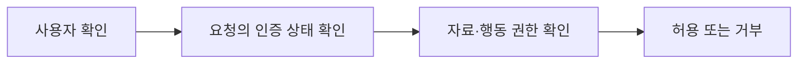

<!-- level:1 -->
# 웹 인증과 인가 — 누구인지 확인하고 할 일을 허용하기

> **한 문장으로:** 로그인은 사용자를 확인하고, 권한 검사는 그 사용자가 특정 자료와 행동에 접근해도 되는지 판단합니다.

## 왜 필요한가요?

내 주문을 보기 위해 로그인했어도 다른 사람의 주문까지 볼 수 있으면 안 됩니다. 신원 확인과 자료별 권한 확인을 모두 해야 합니다.

## 일상에서 떠올려 보기

건물 로비에서 신분증을 확인하는 것과 특정 사무실 출입을 허용하는 것은 다른 판단입니다. 출입증을 갖고 있다고 모든 방에 들어갈 수 있는 것은 아닙니다.

## 순서대로 따라가기

1. 로그인 등으로 현재 사용자가 누구인지 확인합니다.
2. 이후 요청에서 세션이나 토큰으로 인증 상태를 확인합니다.
3. 요청한 자료의 소유자와 행위별 권한을 서버가 별도로 검사합니다.



## 작은 예로 확인하기

A사용자가 로그인한 뒤 주소의 주문 번호만 B의 주문으로 바꿨다고 해 보세요. 서버는 ‘로그인됐는가’와 함께 ‘이 주문을 읽을 권한이 있는가’를 확인해야 합니다. 화면에서 버튼을 숨기는 것만으로 보호할 수 없습니다.

## 처음 만나는 용어

| 용어 | 쉬운 뜻 |
|---|---|
| 인증 | 누구인지 또는 어떤 인증 주체인지 확인하는 것입니다. |
| 인가 | 그 주체가 요청한 자료와 행동을 사용할 권한이 있는지 확인하는 것입니다. |
| 쿠키 | 브라우저가 보관하고 조건에 맞는 요청에 보내는 데이터입니다. |
| 세션·토큰 | 인증 상태를 관리하는 서버 기록 또는 검증 가능한 전달 정보입니다. |

**비유의 한계:** 출입증이 유효한지와 사용할 권한은 매번 적절히 확인해야 합니다. JWT는 그 자체로 암호화된 비밀 상자가 아니며 OAuth2만으로 로그인 신원이 자동 확인되는 것도 아닙니다.

## 스스로 확인

로그인한 사용자면 다른 사람의 주문 번호를 넣어 조회해도 될까요?

**답과 이유:** 안 됩니다. 인증 뒤에도 주문 소유자와 행위별 권한을 서버에서 검사해야 합니다.
<!-- level:2 -->
# 세션과 토큰 검증 경계

<!-- beginner-guide:start -->
## 읽기 전 길잡이

의사코드에서는 인증 상태를 확인하는 부분과 자료 권한을 확인하는 부분을 따로 찾으세요. 토큰은 형태만 읽는 것이 아니라 서명·발급자·대상·만료 조건을 검증해야 합니다.

## 이 단계에서 만날 말

| 용어 | 쉬운 뜻 |
|---|---|
| JWT | 서명 등으로 검증할 수 있는 구조의 토큰 형식입니다. |
| OAuth2 | 다른 서비스의 접근 권한을 위임하는 절차와 규칙입니다. |
| OpenID Connect | OAuth2 위에서 사용자 신원 확인을 제공하는 규격입니다. |
| HttpOnly | 브라우저 JavaScript가 쿠키를 직접 읽지 못하도록 하는 설정입니다. |
| Secure·SameSite | HTTPS 전송과 다른 사이트 요청에서 쿠키 전달을 제어하는 설정입니다. |
| issuer·audience | 토큰을 발급한 주체와 토큰의 사용 대상을 나타내는 정보입니다. |

<!-- beginner-guide:end -->

서버 세션 쿠키에는 Secure·HttpOnly·적절한 SameSite, 경로·도메인·만료 정책을 둔다. HttpOnly는 JavaScript의 읽기를 막지만 XSS가 사용자 대신 요청하는 모든 문제를 없애지는 않는다. CSRF 보호도 요청의 형태와 인증 방식에 맞춰 설계한다.

다음은 **프레임워크 중립 의사코드**다.

```text
handleRequest(request):
  identity = validateSessionOrToken(request)
  require(identity != null)
  resource = loadTopicProgress(request.topicId)
  require(resource.userId == identity.userId)
  validateInput(request.body)
  persistAllowedChange(resource)
```

JWT 검증은 허용 알고리즘·서명·issuer·audience·만료 등을 포함하고 단순 decode와 다르다. 브라우저 OAuth 흐름은 authorization code와 PKCE, state·정확한 redirect 검증을 사용하며 OIDC에는 nonce와 ID token 검증을 포함한다. 최신 보안 권고와 라이브러리 문서를 따른다.
<!-- level:3 -->
# 가상 장애 — 다른 사용자의 진도가 조회된다

<!-- beginner-guide:start -->
## 읽기 전 길잡이

로그인은 되는데 다른 사람의 자료가 보이는 상황을 조사합니다. URL의 식별자를 신뢰했는지와 조회·수정 각각에서 소유권 검사가 있는지 확인하세요.

<!-- beginner-guide:end -->

가상 API가 로그인 여부만 확인하고 path의 user ID로 DB를 조회한다. 인증은 됐지만 소유권 인가가 빠진 BOLA/IDOR다. 사용자가 직접 요청 ID를 바꿀 수 있다는 전제로 테스트해야 한다.

**수정:** user ID는 검증된 세션에서 유도하고 리소스 소유권을 서버·DB RLS에서 확인한다. Supabase RLS의 `TO authenticated`만으로 소유권은 제한되지 않는다. `auth.uid() = user_id` 등의 조건을 사용하고 user-editable metadata를 권한 근거로 쓰지 않는다.

**재검증:** 별도 테스트 사용자 두 명의 읽기·갱신·RPC를 검사한다. 토큰 만료·갱신·세션 종료도 확인하되 운영 사용자 진도를 임의 변경하지 않는다. 응답 캐시가 사용자 데이터를 섞지 않는지도 점검한다.
<!-- level:4 -->
# 상태형 세션과 토큰의 운영 선택

<!-- beginner-guide:start -->
## 읽기 전 길잡이

세션과 토큰의 폐기·만료·보관 방식, 여러 서비스의 권한 약속을 비교합니다. 구현 편의만으로 고르지 말고 인증 상태와 자료 접근 책임을 명확히 하세요.

<!-- beginner-guide:end -->

| 방식 | 이득 | 비용 |
|---|---|---|
| 서버 세션 | 중앙 revoke·상태 제어 | 저장소·고가용성 |
| 짧은 access token | 검증 분산 가능 | revoke·claim 신선도·키 회전 |
| refresh 세션 | 짧은 토큰과 재인증 균형 | 회전·재사용 탐지·기기 관리 |

권한 변경이 즉시 반영되어야 하는 작업에는 JWT claim만 믿는 정책의 신선도를 검토한다. 세션 저장·캐시·CDN·감사 로그를 사용자별로 격리한다. service role 키는 브라우저에 넣지 않는다. 외부 로그인 제공자가 성공해도 앱의 계정 연결·조직 권한·탈퇴 처리는 별도다.

참고: [OAuth Security BCP RFC 9700](https://www.rfc-editor.org/rfc/rfc9700), [OpenID Connect Core](https://openid.net/specs/openid-connect-core-1_0.html), [Supabase RLS](https://supabase.com/docs/guides/database/postgres/row-level-security).
<!-- quizzes -->
[{"level":1,"question":"인증과 인가의 관계로 정확한 것은?","choices":["로그인하면 모든 리소스에 권한","쿠키는 항상 인가 규칙","JWT payload는 항상 암호화","신원 확인 뒤 리소스·행위별 권한을 별도 검증"],"answer_index":3,"explanation":"인증은 신원, 인가는 허용 행위를 다룹니다. 토큰과 쿠키 형식만으로 소유권·업무 권한이 생기지 않습니다."},{"level":2,"question":"JWT decode와 검증의 차이는?","choices":["검증은 서명·issuer·audience·만료 등 계약을 확인","decode만으로 신뢰 가능","JWT는 알고리즘 확인 불필요","payload 읽기는 암호 해제"],"answer_index":0,"explanation":"decode는 내용 읽기일 뿐입니다. 신뢰할 발급자·대상·알고리즘·유효기간과 서명을 검증해야 합니다."},{"level":3,"question":"Supabase TO authenticated만 있는 RLS의 한계는?","choices":["로그인도 불가능","행의 사용자 소유권을 자동 제한하지 않음","모든 사용자 행이 암호화","service role을 브라우저에 제공"],"answer_index":1,"explanation":"역할 제한은 인증 조건이지 소유권 조건이 아닙니다. auth.uid와 user_id 같은 행별 인가를 함께 적용합니다."},{"level":4,"question":"짧은 JWT 기반 권한에서 추가 검토할 것은?","choices":["토큰 길이만","모든 로그에 토큰 공개","revoke·claim 신선도·키 회전·세션 정책","권한 변경은 무관"],"answer_index":2,"explanation":"서명 토큰은 만료까지 유효할 수 있고 claim도 낡을 수 있습니다. 업무의 즉시 권한 변경 요구에 맞는 세션 검증을 설계합니다."}]
