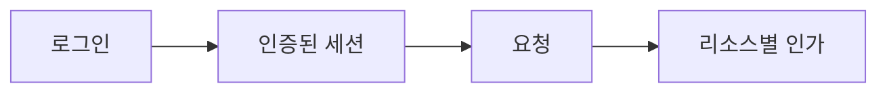

<!-- level:1 -->
# 웹 인증과 인가 — 누구인지와 무엇을 할 수 있는지

출입증은 신원을 확인하는 데 도움을 주지만 모든 방을 열 권한을 주지는 않는다. 인증은 사용자가 누구인지, 인가는 특정 행위·데이터에 접근할 수 있는지를 확인한다. 쿠키는 브라우저가 특정 조건에 맞춰 자동 전송하는 저장·전달 방식이고, 세션은 서버 측 상태와 식별자를 연결하는 방식이다.



JWT는 서명 등을 포함하는 토큰 형식이며 자체가 로그인 프로토콜은 아니다. OAuth 2.0은 위임된 접근 권한을 다루고 OpenID Connect는 그 위에서 인증 정보를 제공한다. OAuth access token을 아무 검증 없이 사용자 신원 증명으로 쓰지 않는다.

**비유의 한계:** 서명된 JWT의 payload는 보통 암호화된 비밀이 아니다. 로그아웃 버튼을 눌렀다고 이미 발급된 모든 토큰이 즉시 무효화된다는 보장도 없다.
<!-- level:2 -->
# 세션과 토큰 검증 경계

서버 세션 쿠키에는 Secure·HttpOnly·적절한 SameSite, 경로·도메인·만료 정책을 둔다. HttpOnly는 JavaScript의 읽기를 막지만 XSS가 사용자 대신 요청하는 모든 문제를 없애지는 않는다. CSRF 보호도 요청의 형태와 인증 방식에 맞춰 설계한다.

다음은 **프레임워크 중립 의사코드**다.

```text
handleRequest(request):
  identity = validateSessionOrToken(request)
  require(identity != null)
  resource = loadTopicProgress(request.topicId)
  require(resource.userId == identity.userId)
  validateInput(request.body)
  persistAllowedChange(resource)
```

JWT 검증은 허용 알고리즘·서명·issuer·audience·만료 등을 포함하고 단순 decode와 다르다. 브라우저 OAuth 흐름은 authorization code와 PKCE, state·정확한 redirect 검증을 사용하며 OIDC에는 nonce와 ID token 검증을 포함한다. 최신 보안 권고와 라이브러리 문서를 따른다.
<!-- level:3 -->
# 가상 장애 — 다른 사용자의 진도가 조회된다

가상 API가 로그인 여부만 확인하고 path의 user ID로 DB를 조회한다. 인증은 됐지만 소유권 인가가 빠진 BOLA/IDOR다. 사용자가 직접 요청 ID를 바꿀 수 있다는 전제로 테스트해야 한다.

**수정:** user ID는 검증된 세션에서 유도하고 리소스 소유권을 서버·DB RLS에서 확인한다. Supabase RLS의 `TO authenticated`만으로 소유권은 제한되지 않는다. `auth.uid() = user_id` 등의 조건을 사용하고 user-editable metadata를 권한 근거로 쓰지 않는다.

**재검증:** 별도 테스트 사용자 두 명의 읽기·갱신·RPC를 검사한다. 토큰 만료·갱신·세션 종료도 확인하되 운영 사용자 진도를 임의 변경하지 않는다. 응답 캐시가 사용자 데이터를 섞지 않는지도 점검한다.
<!-- level:4 -->
# 상태형 세션과 토큰의 운영 선택

| 방식 | 이득 | 비용 |
|---|---|---|
| 서버 세션 | 중앙 revoke·상태 제어 | 저장소·고가용성 |
| 짧은 access token | 검증 분산 가능 | revoke·claim 신선도·키 회전 |
| refresh 세션 | 짧은 토큰과 재인증 균형 | 회전·재사용 탐지·기기 관리 |

권한 변경이 즉시 반영되어야 하는 작업에는 JWT claim만 믿는 정책의 신선도를 검토한다. 세션 저장·캐시·CDN·감사 로그를 사용자별로 격리한다. service role 키는 브라우저에 넣지 않는다. 외부 로그인 제공자가 성공해도 앱의 계정 연결·조직 권한·탈퇴 처리는 별도다.

참고: [OAuth Security BCP RFC 9700](https://www.rfc-editor.org/rfc/rfc9700), [OpenID Connect Core](https://openid.net/specs/openid-connect-core-1_0.html), [Supabase RLS](https://supabase.com/docs/guides/database/postgres/row-level-security).
<!-- quizzes -->
[{"level":1,"question":"인증과 인가의 관계로 정확한 것은?","choices":["로그인하면 모든 리소스에 권한","쿠키는 항상 인가 규칙","JWT payload는 항상 암호화","신원 확인 뒤 리소스·행위별 권한을 별도 검증"],"answer_index":3,"explanation":"인증은 신원, 인가는 허용 행위를 다룹니다. 토큰과 쿠키 형식만으로 소유권·업무 권한이 생기지 않습니다."},{"level":2,"question":"JWT decode와 검증의 차이는?","choices":["검증은 서명·issuer·audience·만료 등 계약을 확인","decode만으로 신뢰 가능","JWT는 알고리즘 확인 불필요","payload 읽기는 암호 해제"],"answer_index":0,"explanation":"decode는 내용 읽기일 뿐입니다. 신뢰할 발급자·대상·알고리즘·유효기간과 서명을 검증해야 합니다."},{"level":3,"question":"Supabase TO authenticated만 있는 RLS의 한계는?","choices":["로그인도 불가능","행의 사용자 소유권을 자동 제한하지 않음","모든 사용자 행이 암호화","service role을 브라우저에 제공"],"answer_index":1,"explanation":"역할 제한은 인증 조건이지 소유권 조건이 아닙니다. auth.uid와 user_id 같은 행별 인가를 함께 적용합니다."},{"level":4,"question":"짧은 JWT 기반 권한에서 추가 검토할 것은?","choices":["토큰 길이만","모든 로그에 토큰 공개","revoke·claim 신선도·키 회전·세션 정책","권한 변경은 무관"],"answer_index":2,"explanation":"서명 토큰은 만료까지 유효할 수 있고 claim도 낡을 수 있습니다. 업무의 즉시 권한 변경 요구에 맞는 세션 검증을 설계합니다."}]
