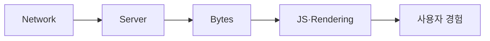

<!-- level:1 -->
# 웹 성능 — 사용자가 보고 반응하는 전체 경로

페이지는 서버가 빠르게 응답했다고 즉시 사용 가능해지는 것이 아니다. 이름 해석·연결·응답·다운로드·JS 실행·렌더링이 이어진다. 사용자는 중요한 내용이 언제 보이는지, 입력에 얼마나 빨리 반응하는지, 화면이 움직이는지 체감한다.



LCP는 큰 주요 콘텐츠 표시, INP는 입력 상호작용의 반응, CLS는 예상치 못한 layout 이동을 평가하는 Core Web Vitals다. lab 검사는 통제된 진단에, field 데이터는 실제 사용자 분포에 도움을 준다. 둘의 숫자가 반드시 같지는 않다.

**비유의 한계:** 점수 하나로 모든 사용자 경험과 업무 성공을 설명할 수 없다. 기기·지역·연결·로그인 상태를 포함한 분포와 정확성을 함께 본다.
<!-- level:2 -->
# 전달량과 실행 비용 줄이기

크고 늦게 발견되는 이미지, render-blocking 리소스, 긴 JS 작업을 분해한다. 압축·캐시·CDN·코드 분할은 각각 다른 비용을 줄인다. 브라우저 캐시와 서버 응답 캐시의 개인화 경계를 명시한다.

다음 HTML은 이미지 공간을 미리 확보하는 학습 예제다.

```html


```

주요 LCP 이미지를 무조건 lazy loading하면 발견과 다운로드가 늦어질 수 있다. 화면 아래 이미지는 lazy loading을 검토한다. preload·높은 우선순위를 모든 리소스에 주면 실제 우선순위가 무너진다. Content-Encoding 압축과 이미지 포맷·해상도는 데이터를 줄이지만 CPU·품질·호환성을 확인한다.

**실습:** DevTools waterfall과 main-thread 작업을 보고 지연이 서버·전달·실행 중 어디에 있는지 분류하자.
<!-- level:3 -->
# 가상 장애 — CDN 캐시가 사용자 진도를 섞는다

가상 개인화 HTML을 공용 캐시로 저장해 다른 사용자에게 보여 주는 문제다. 성능 개선이 보안·정확성을 악화시킬 수 있다. Cache-Control, Vary, 인증 쿠키, edge·브라우저 캐시와 실제 응답을 대조한다.

**수정:** 사용자 데이터 응답은 적절한 private/no-store 계약을 적용하고 공개 콘텐츠는 버전·tag 기반 캐시로 분리한다. 최신성·로그인·권한 경계를 프레임워크 캐시 설정과 맞춘다. 불필요한 DB 조회는 안전한 공개 데이터 캐시로 줄일 수 있다.

**재검증:** 서로 다른 테스트 사용자, cold/warm 캐시, 콘텐츠 변경, 모바일 저성능 기기를 확인한다. field 지표·오류율·데이터 정확성을 함께 측정한다. 한 번의 Lighthouse 결과만으로 운영 전체 성공을 선언하지 않는다.
<!-- level:4 -->
# 트래픽 증가의 비용과 단계적 최적화

| 개선 | 기대 이득 | 주의 |
|---|---|---|
| CDN·공개 캐시 | 원본 부하·지역 지연 감소 | 신선도·인가·무효화 |
| 응답·이미지 축소 | 전송·메모리 감소 | 품질·계약 |
| JS 분할·지연 | 초기 실행 비용 감소 | 후속 로딩·실패 UX |
| 서버·DB 개선 | TTFB·처리량 개선 | 앱 렌더링 병목은 별도 |

사용자 흐름별 예산을 정하고 병목 비중이 큰 곳을 먼저 개선한다. 공통 리소스·CDN·DB·CPU의 포화와 캐시 장애 시 원본 용량을 고려한다. 성능 최적화는 정확성·접근성·보안을 만족하며 rollout과 실제 사용자 관측으로 검증한다.

참고: [web.dev Web Vitals](https://web.dev/articles/vitals), [LCP 최적화](https://web.dev/articles/optimize-lcp), [MDN HTTP Caching](https://developer.mozilla.org/en-US/docs/Web/HTTP/Guides/Caching).
<!-- quizzes -->
[{"level":1,"question":"lab와 field 성능 데이터의 관계는?","choices":["완전히 같은 결과 보장","field는 항상 불필요","통제 진단과 실제 사용자 분포를 보완","점수 하나가 모든 UX 증명"],"answer_index":2,"explanation":"실험 환경과 실제 기기·지역·사용 상태는 다릅니다. 원인 진단과 사용자 영향을 함께 확인합니다."},{"level":2,"question":"주요 LCP 이미지 로딩의 합리적 출발점은?","choices":["발견·우선순위를 확인하며 무조건 lazy 처리하지 않음","모든 이미지를 lazy 처리","모든 리소스 최고 우선순위","크기 속성 제거"],"answer_index":0,"explanation":"중요 이미지를 늦게 발견하면 LCP가 악화될 수 있습니다. 필요한 우선순위와 공간 예약을 실제 waterfall로 확인합니다."},{"level":3,"question":"개인화 응답을 CDN 캐시할 때 중요한 계약은?","choices":["항상 public 무제한","사용자·인가·신선도와 Cache-Control 경계","쿠키는 무관","서로 다른 사용자 테스트 금지"],"answer_index":1,"explanation":"잘못된 공유 캐시는 사용자 데이터를 섞을 수 있습니다. 공개·개인화 응답의 캐시 범위를 명확히 검증해야 합니다."},{"level":4,"question":"웹 최적화 우선순위를 정하는 기준은?","choices":["유행 도구만","무조건 서버만 증설","Lighthouse 한 번 점수만","실제 병목 비중·사용자 흐름·정확성·접근성·비용"],"answer_index":3,"explanation":"전체 경로의 비용을 분해하고 실제 사용자 지표로 검증합니다. 성능이 보안이나 기능 정확성을 해치지 않아야 합니다."}]
