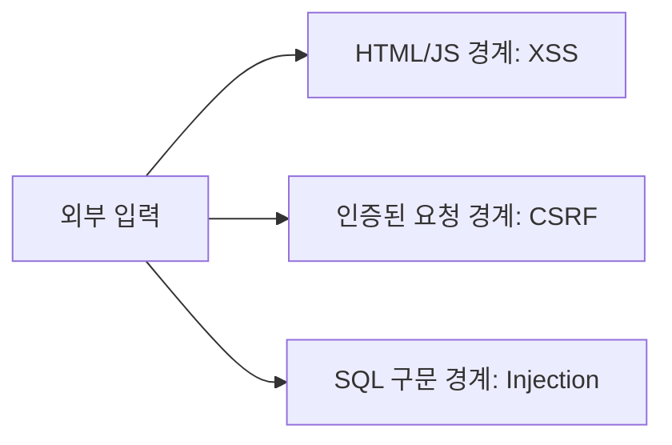

<!-- level:1 -->
# XSS·CSRF·SQL Injection — 서로 다른 신뢰 경계

외부 입력을 어디에서 어떤 의미로 해석하느냐가 보안의 핵심이다. XSS는 공격자 입력이 브라우저의 실행 코드로 해석되는 문제, CSRF는 사용자의 자동 전달 인증을 이용해 원하지 않는 요청을 보내는 문제, SQL injection은 입력이 SQL 구문으로 해석되는 문제다. 한 가지 “특수문자 제거”로 모두 해결할 수 없다.



출력은 문맥에 맞게 인코딩하고, 상태 변경 요청은 인증·인가와 CSRF 정책을 검사하며, SQL은 파라미터를 데이터로 바인딩한다. 입력 검증은 보완책이고 권한·출력 처리·질의 경계를 대신하지 않는다.

**비유의 한계:** React의 일반 텍스트 렌더링이 escape해도 raw HTML·URL·외부 Markdown·SVG 처리에는 별도 검토가 필요하다.
<!-- level:2 -->
# 방어를 해당 문맥에서 적용하기

Python 3 표준 sqlite3로 파라미터 바인딩을 확인하는 안전한 로컬 예제다.

```python
import sqlite3
db = sqlite3.connect(":memory:")
db.execute("CREATE TABLE users(name TEXT)")
db.execute("INSERT INTO users VALUES (?)", ("alice",))
untrusted = "alice' OR 1=1 --"
rows = db.execute("SELECT name FROM users WHERE name=?", (untrusted,)).fetchall()
assert rows == []
db.close()
```

사용자 입력을 문자열로 SQL에 이어 붙이지 않는다. 테이블·컬럼 이름처럼 바인딩할 수 없는 식별자는 허용 목록으로 선택한다. HTML 문맥에는 텍스트 escaping, 제한된 rich HTML에는 검증된 sanitizer를 사용한다. CSP는 추가 방어이며 안전한 출력 처리를 대체하지 않는다.

CSRF는 쿠키의 SameSite·검증 토큰·Origin 검사를 요청 유형과 환경에 맞춰 조합한다. CORS는 모든 CSRF를 막는 일반 방화벽이 아니다. 상태 변경을 GET으로 구현하지 않는다.
<!-- level:3 -->
# 가상 장애 — Markdown 다이어그램이 실행 경로가 된다

가상 앱이 LLM·사용자 Markdown을 raw HTML·SVG로 렌더링한다. 일반 React 텍스트 escaping을 우회한 경계에서 이벤트 속성·URL·HTML이 위험할 수 있다. 데이터 출처를 신뢰하지 않는다는 전제로 renderer와 sanitizer 설정을 확인한다.

**수정:** 필요한 Markdown 기능만 허용하고 raw HTML을 제한한다. Mermaid 보안 모드·SVG sanitizer·링크 정책을 검토하며 CSP를 추가 방어로 활용한다. 서버의 SQL 바인딩과 행별 인가도 별도로 유지한다. sanitizer 버전 업데이트는 회귀 검증을 포함한다.

**재검증:** 로컬 테스트 환경에서 허용된 안전 콘텐츠와 위험 문맥 테스트를 수행한다. 스크립트 실행·잘못된 URL·cross-user 접근이 차단되는지 확인하고 운영 사이트에 공격 페이로드를 무단 제출하지 않는다.
<!-- level:4 -->
# 여러 겹의 방어와 운영 책임

| 경계 | 기본 방어 | 보완 |
|---|---|---|
| 출력 | 문맥 인코딩·rich HTML 정화 | CSP·위험 API 제한 |
| 상태 요청 | 인증·인가·CSRF 정책 | rate limit·감사 |
| DB 질의 | 파라미터 바인딩·최소 권한 | 제약·RLS·검증 |

입력은 API·파일·관리자 화면·LLM 출력에서 들어올 수 있다. “관리자만 입력”도 계정 탈취나 데이터 이행 경계를 검토해야 한다. 대규모 시스템은 dependency·secret·로그·권한·보안 패치와 위협 모델을 함께 관리한다. 자동 스캐너 통과가 모든 업무 인가 결함을 증명하지는 않는다.

참고: [OWASP XSS Prevention](https://cheatsheetseries.owasp.org/cheatsheets/Cross_Site_Scripting_Prevention_Cheat_Sheet.html), [CSRF Prevention](https://cheatsheetseries.owasp.org/cheatsheets/Cross-Site_Request_Forgery_Prevention_Cheat_Sheet.html), [SQL Injection Prevention](https://cheatsheetseries.owasp.org/cheatsheets/SQL_Injection_Prevention_Cheat_Sheet.html).
<!-- quizzes -->
[{"level":1,"question":"세 웹 공격을 다루는 올바른 원칙은?","choices":["특수문자 하나 제거면 모두 해결","각 신뢰 경계와 문맥에 맞는 방어 적용","React이면 모든 입력 안전","CORS만으로 모든 인가 해결"],"answer_index":1,"explanation":"브라우저 코드·인증 요청·SQL 구문은 다른 경계입니다. 인코딩·CSRF 정책·바인딩과 행별 인가를 각각 설계합니다."},{"level":2,"question":"SQL 파라미터 바인딩의 핵심 효과는?","choices":["모든 데이터 암호화","권한 자동 생성","입력을 구문이 아닌 데이터로 전달","테이블 이름 자유 삽입"],"answer_index":2,"explanation":"값을 SQL 구문과 분리합니다. 동적 식별자는 허용 목록 등 별도 처리하고 DB 최소 권한과 인가도 유지합니다."},{"level":3,"question":"LLM Markdown을 렌더링할 때 필요한 판단은?","choices":["출력을 신뢰하지 않고 raw HTML·SVG·URL 경계 검토","LLM이라 항상 안전","관리자 글이면 검사 불필요","sanitizer 하나면 서버 권한 불필요"],"answer_index":0,"explanation":"생성된 출력도 외부 데이터입니다. renderer·보안 모드·정화·링크 정책을 확인하고 서버 인가·질의 방어를 따로 유지합니다."},{"level":4,"question":"CSP의 역할로 정확한 것은?","choices":["출력 인코딩을 완전히 대체","SQL 구문 검증","모든 업무 인가 자동 구현","안전한 출력 처리에 더하는 보완 방어"],"answer_index":3,"explanation":"CSP는 허용 실행·출처 정책을 제한하는 보완 수단입니다. 취약한 출력 경계와 업무 권한을 자동 고치지는 않습니다."}]
