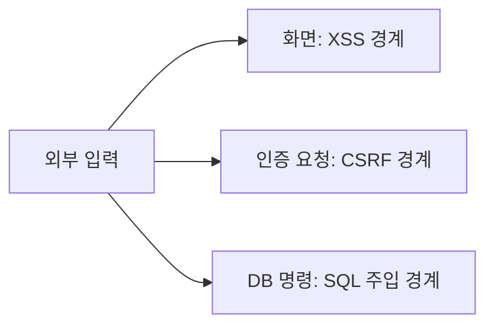

<!-- level:1 -->
# 웹 보안 — 받은 데이터를 어디까지 믿을지 정하기

> **한 문장으로:** 화면 코드, 사용자 요청, 데이터베이스 명령의 경계를 구분해 외부 입력이 권한 있는 명령으로 바뀌지 않게 합니다.

## 왜 필요한가요?

입력란의 내용이나 외부 문서를 그대로 믿으면 다른 사용자의 브라우저에서 코드가 실행되거나 원치 않는 자료 변경이 일어날 수 있습니다. 입력이 사용되는 위치마다 맞는 방어가 필요합니다.

## 일상에서 떠올려 보기

손님이 제출한 메모는 직원에게 참고 자료입니다. 메모 안에 ‘금고를 열어라’라고 적혔다고 운영 규칙이 바뀌면 안 됩니다. 컴퓨터에서도 사용자 데이터와 실행할 명령을 구별해야 합니다.

## 순서대로 따라가기

1. 입력이 화면의 글인지, 요청의 데이터인지, DB 검색값인지 구분합니다.
2. 해당 위치에 맞게 출력 인코딩·안전한 요청 검증·파라미터 바인딩 등을 적용합니다.
3. 서버에서 자료별 권한을 확인하고 예상 밖 입력과 공격 조건을 검사합니다.



## 작은 예로 확인하기

XSS는 입력이 브라우저에서 실행 코드로 해석되는 문제입니다. CSRF는 다른 사이트가 사용자의 인증 상태를 이용한 원치 않는 요청을 유도하는 문제입니다. SQL Injection은 입력이 DB 명령의 구조에 섞이는 문제입니다. 셋 모두 ‘입력을 확인하자’로만 끝내면 방어할 위치를 놓칩니다.

## 처음 만나는 용어

| 용어 | 쉬운 뜻 |
|---|---|
| XSS | 외부 입력이 사용자 브라우저의 실행 코드로 이어지는 공격입니다. |
| CSRF | 다른 사이트에서 사용자의 인증을 이용한 원치 않는 요청을 유도하는 공격입니다. |
| SQL Injection | 입력이 데이터베이스 명령 구조에 섞여 의도 밖의 명령이 되는 공격입니다. |
| 신뢰 경계 | 어떤 입력이나 주체를 어느 범위까지 믿을지 나누는 선입니다. |

**비유의 한계:** 현실의 메모와 웹 코드 실행 조건은 다릅니다. 검증 도구 하나가 모든 위치의 공격을 막지는 않으며, 보안 설정과 자료별 권한을 함께 적용해야 합니다.

## 스스로 확인

XSS·CSRF·SQL Injection에 같은 문자열 검사 하나만 적용하면 충분할까요?

**답과 이유:** 충분하지 않습니다. 입력이 화면, 인증 요청, DB 명령 중 어느 경계를 지나는지에 맞는 방어가 필요합니다.
<!-- level:2 -->
# 방어를 해당 문맥에서 적용하기

<!-- beginner-guide:start -->
## 읽기 전 길잡이

로컬 SQL 예제에서 명령 문자열과 값을 따로 전달하는 부분을 보세요. 입력 내용을 명령에 직접 이어 붙이지 않는 이유를 작은 데이터로 확인할 수 있습니다.

## 이 단계에서 만날 말

| 용어 | 쉬운 뜻 |
|---|---|
| 출력 인코딩 | 글을 쓰는 위치에 맞게 기호가 코드로 해석되지 않도록 표현하는 것입니다. |
| 파라미터 바인딩 | SQL의 구조와 입력값을 분리해 전달하는 방법입니다. |
| CSRF 토큰 | 요청이 허용된 흐름에서 왔는지 확인하는 보호값입니다. |
| CSP | 브라우저가 사용할 콘텐츠와 실행 출처 등을 제한하는 정책입니다. |
| 정화(sanitization) | 허용하지 않는 태그나 속성 등을 제거하는 처리입니다. |
| Origin | 요청 출처를 구성하는 프로토콜·호스트·포트 정보입니다. |

<!-- beginner-guide:end -->

Python 3 표준 sqlite3로 파라미터 바인딩을 확인하는 안전한 로컬 예제다.

```python
import sqlite3
db = sqlite3.connect(":memory:")
db.execute("CREATE TABLE users(name TEXT)")
db.execute("INSERT INTO users VALUES (?)", ("alice",))
untrusted = "alice' OR 1=1 --"
rows = db.execute("SELECT name FROM users WHERE name=?", (untrusted,)).fetchall()
assert rows == []
db.close()
```

사용자 입력을 문자열로 SQL에 이어 붙이지 않는다. 테이블·컬럼 이름처럼 바인딩할 수 없는 식별자는 허용 목록으로 선택한다. HTML 문맥에는 텍스트 escaping, 제한된 rich HTML에는 검증된 sanitizer를 사용한다. CSP는 추가 방어이며 안전한 출력 처리를 대체하지 않는다.

CSRF는 쿠키의 SameSite·검증 토큰·Origin 검사를 요청 유형과 환경에 맞춰 조합한다. CORS는 모든 CSRF를 막는 일반 방화벽이 아니다. 상태 변경을 GET으로 구현하지 않는다.
<!-- level:3 -->
# 가상 장애 — Markdown 다이어그램이 실행 경로가 된다

<!-- beginner-guide:start -->
## 읽기 전 길잡이

허용된 입력인 줄 알았는데 위험한 위치에서 다시 해석되는 사례를 봅니다. 처음 입력부터 최종 화면·요청·DB 사용까지 데이터 경로를 따라 조사하세요.

<!-- beginner-guide:end -->

가상 앱이 LLM·사용자 Markdown을 raw HTML·SVG로 렌더링한다. 일반 React 텍스트 escaping을 우회한 경계에서 이벤트 속성·URL·HTML이 위험할 수 있다. 데이터 출처를 신뢰하지 않는다는 전제로 renderer와 sanitizer 설정을 확인한다.

**수정:** 필요한 Markdown 기능만 허용하고 raw HTML을 제한한다. Mermaid 보안 모드·SVG sanitizer·링크 정책을 검토하며 CSP를 추가 방어로 활용한다. 서버의 SQL 바인딩과 행별 인가도 별도로 유지한다. sanitizer 버전 업데이트는 회귀 검증을 포함한다.

**재검증:** 로컬 테스트 환경에서 허용된 안전 콘텐츠와 위험 문맥 테스트를 수행한다. 스크립트 실행·잘못된 URL·cross-user 접근이 차단되는지 확인하고 운영 사이트에 공격 페이로드를 무단 제출하지 않는다.
<!-- level:4 -->
# 여러 겹의 방어와 운영 책임

<!-- beginner-guide:start -->
## 읽기 전 길잡이

보안은 인증·인가·입력·출력·브라우저 정책의 여러 경계를 연결하는 설계입니다. 공격을 가정한 검사와 기능 변경의 유지 비용까지 함께 판단하세요.

<!-- beginner-guide:end -->

| 경계 | 기본 방어 | 보완 |
|---|---|---|
| 출력 | 문맥 인코딩·rich HTML 정화 | CSP·위험 API 제한 |
| 상태 요청 | 인증·인가·CSRF 정책 | rate limit·감사 |
| DB 질의 | 파라미터 바인딩·최소 권한 | 제약·RLS·검증 |

입력은 API·파일·관리자 화면·LLM 출력에서 들어올 수 있다. “관리자만 입력”도 계정 탈취나 데이터 이행 경계를 검토해야 한다. 대규모 시스템은 dependency·secret·로그·권한·보안 패치와 위협 모델을 함께 관리한다. 자동 스캐너 통과가 모든 업무 인가 결함을 증명하지는 않는다.

참고: [OWASP XSS Prevention](https://cheatsheetseries.owasp.org/cheatsheets/Cross_Site_Scripting_Prevention_Cheat_Sheet.html), [CSRF Prevention](https://cheatsheetseries.owasp.org/cheatsheets/Cross-Site_Request_Forgery_Prevention_Cheat_Sheet.html), [SQL Injection Prevention](https://cheatsheetseries.owasp.org/cheatsheets/SQL_Injection_Prevention_Cheat_Sheet.html).
<!-- quizzes -->
[{"level":1,"question":"세 웹 공격을 다루는 올바른 원칙은?","choices":["특수문자 하나 제거면 모두 해결","각 신뢰 경계와 문맥에 맞는 방어 적용","React이면 모든 입력 안전","CORS만으로 모든 인가 해결"],"answer_index":1,"explanation":"브라우저 코드·인증 요청·SQL 구문은 다른 경계입니다. 인코딩·CSRF 정책·바인딩과 행별 인가를 각각 설계합니다."},{"level":2,"question":"SQL 파라미터 바인딩의 핵심 효과는?","choices":["모든 데이터 암호화","권한 자동 생성","입력을 구문이 아닌 데이터로 전달","테이블 이름 자유 삽입"],"answer_index":2,"explanation":"값을 SQL 구문과 분리합니다. 동적 식별자는 허용 목록 등 별도 처리하고 DB 최소 권한과 인가도 유지합니다."},{"level":3,"question":"LLM Markdown을 렌더링할 때 필요한 판단은?","choices":["출력을 신뢰하지 않고 raw HTML·SVG·URL 경계 검토","LLM이라 항상 안전","관리자 글이면 검사 불필요","sanitizer 하나면 서버 권한 불필요"],"answer_index":0,"explanation":"생성된 출력도 외부 데이터입니다. renderer·보안 모드·정화·링크 정책을 확인하고 서버 인가·질의 방어를 따로 유지합니다."},{"level":4,"question":"CSP의 역할로 정확한 것은?","choices":["출력 인코딩을 완전히 대체","SQL 구문 검증","모든 업무 인가 자동 구현","안전한 출력 처리에 더하는 보완 방어"],"answer_index":3,"explanation":"CSP는 허용 실행·출처 정책을 제한하는 보완 수단입니다. 취약한 출력 경계와 업무 권한을 자동 고치지는 않습니다."}]
